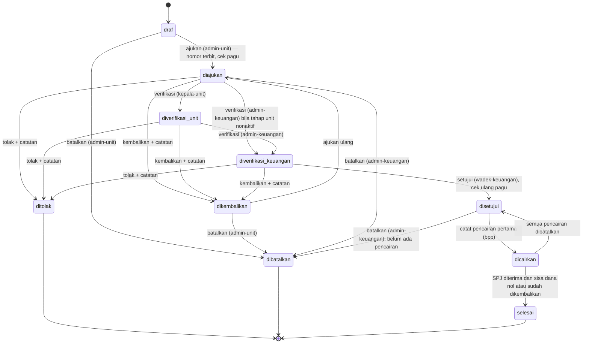
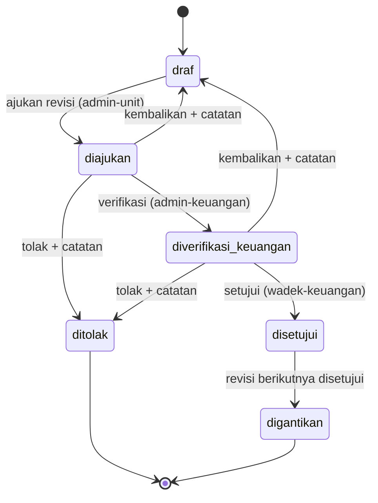
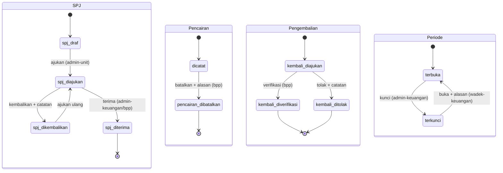

# 01 — Product Requirements Document (PRD)
# Sistem Keuangan Fakultas — FKIP Universitas Siliwangi

| Atribut | Isi |
|---|---|
| Nama aplikasi | Keuangan FKIP Unsil (repo: `keuangan-fkip`) |
| Versi dokumen | 1.0 — 6 Oktober 2026 |
| Pemilik produk | Admin Keuangan Fakultas (sesuaikan dengan struktur Unsil) |
| Stack | Laravel 13, Filament 5, MySQL 8.4, Redis 7 (lihat `02-ARSITEKTUR.md`, `STANDAR-TEKNIS.md`) |
| Status | Draf untuk dibangun; **bergantung pada keputusan `docs/keputusan/0001-batas-cakupan.md` (Fase F0)** |

---

## 1. Latar belakang dan masalah

FKIP Unsil mengelola dana kegiatan untuk banyak unit (program studi, laboratorium, unit pendukung, pimpinan fakultas). Saat ini alur keuangan kegiatan umumnya berjalan dengan berkas Excel/Word, tanda tangan basah, dan kiriman WhatsApp. Akibatnya:

1. **Sisa pagu unit tidak diketahui seketika.** Prodi mengajukan kegiatan tanpa tahu berapa anggaran yang tersisa; Admin Keuangan harus menghitung manual.
2. **RAB tidak konsisten.** Total di lembar RAB sering tidak sama dengan jumlah rinciannya; revisi menimpa berkas lama sehingga riwayat hilang.
3. **Persetujuan sulit dilacak.** Tidak jelas siapa yang sudah memeriksa, kapan, dan apa catatannya.
4. **SPJ terlambat dan bukti tercecer.** Kuitansi/nota dikirim terpisah, tidak terhubung ke item RAB; tidak ada pengingat batas waktu pertanggungjawaban.
5. **Sisa dana dan potongan pajak tidak terekap.** Rekap pengembalian sisa dana dan pajak yang dipotong dibuat ulang setiap akhir bulan.
6. **Data periode lalu bisa berubah.** Laporan bulan yang sudah dilaporkan ke universitas dapat berbeda bila berkas sumber diubah belakangan.
7. **Pimpinan tidak memiliki dasbor** anggaran vs realisasi per unit dan per periode.

Sistem ini menjadi **satu sumber data** untuk siklus: pagu → pengajuan kegiatan + RAB → persetujuan berjenjang → pencairan → SPJ/realisasi + bukti → pengembalian sisa → laporan periodik dan kunci periode.

### 1.1 Batas cakupan terhadap aplikasi yang sudah ada (WAJIB diputuskan di F0)

Ada dua aplikasi yang beririsan:

| Aplikasi | Keadaan | Irisan |
|---|---|---|
| **fkipapp** (honor ujian: proposal, seminar, sidang) | Sudah berjalan | Honor ujian adalah belanja fakultas. **Sistem ini TIDAK menghitung honor ujian.** Bila perlu, cukup mengimpor **rekap total** (per bulan, per prodi, per jenis ujian) dari ekspor Excel fkipapp untuk ditampilkan di dasbor/laporan. |
| **Laporan Keuangan** (`/laporankeuangan/`, ditautkan dari portal Support System FKIP) | Kodenya tidak ada di folder sistem ini; fungsinya perlu diinventarisasi | Berpotensi tumpang tindih dengan modul laporan/realisasi. |

Opsi yang harus diputuskan dan dicatat di `docs/keputusan/0001-batas-cakupan.md` sebelum membangun modul apa pun:

- **Opsi (a) — Menggantikan `laporankeuangan`.** Sistem ini menjadi aplikasi keuangan kegiatan tunggal. Konsekuensi: perlu rencana migrasi data historis dari `laporankeuangan` (minimal saldo/rekap per tahun anggaran berjalan), periode paralel (mis. satu bulan input ganda), pengalihan tautan portal `/laporankeuangan/` ke aplikasi baru, dan pengarsipan aplikasi lama (baca-saja).
- **Opsi (b) — Melengkapi `laporankeuangan`.** `laporankeuangan` tetap dipakai untuk fungsi yang sudah dimilikinya (mis. laporan ke universitas); sistem ini fokus pada siklus kegiatan (RAB → SPJ). Konsekuensi: harus ditetapkan **pembagian data** (siapa sumber kebenaran untuk angka apa), format ekspor dari sistem ini yang dapat dibaca `laporankeuangan` (Excel), dan dua tautan berbeda di portal dengan label yang jelas.

Kedua opsi **tidak mengubah desain inti** di dokumen ini; yang berubah hanya: langkah F11.5 (impor rekap honor), F12.4 (migrasi data — hanya opsi a), dan teks tautan portal.

---

## 2. Dasar regulasi

> Daftar ini adalah rujukan desain, bukan nasihat hukum. Nomor pasal hanya dicantumkan bila diketahui pasti; selebihnya ditandai **(perlu verifikasi)** dan harus dicek oleh Admin Keuangan/bagian hukum sebelum rilis.

| No | Peraturan | Relevansi untuk sistem | Catatan |
|---|---|---|---|
| R1 | **UU No. 17 Tahun 2003 tentang Keuangan Negara** | Asas pengelolaan keuangan negara (tertib, taat peraturan, efisien, ekonomis, efektif, transparan, bertanggung jawab) → dasar jejak audit, pemisahan tugas, dan transparansi laporan | Asas tersebut termuat di Pasal 3 ayat (1) **(perlu verifikasi)** |
| R2 | **PP No. 23 Tahun 2005 tentang Pengelolaan Keuangan Badan Layanan Umum**, sebagaimana telah diubah dengan **PP No. 74 Tahun 2012** | Berlaku bila Unsil berstatus PTN-BLU: fleksibilitas pengelolaan pendapatan/belanja, RBA | **Status perubahan terkini perlu verifikasi.** **Status Unsil (PTN Satker atau PTN-BLU) perlu verifikasi** — desain tidak bergantung pada status ini; cukup pengaturan `pola_pengelolaan` (BR-25) |
| R3 | UU No. 1 Tahun 2004 tentang Perbendaharaan Negara | Peran bendahara pengeluaran, pertanggungjawaban, pengembalian sisa uang | Pasal rujukan **perlu verifikasi** |
| R4 | Peraturan Menteri Keuangan tentang **Bagan Akun Standar (BAS)** | Kode akun/mata anggaran (mis. 52xxxx belanja barang) | Nomor PMK/KMK terbaru **perlu verifikasi**; master akun diisi lewat impor, seeder hanya **contoh** |
| R5 | Peraturan Menteri Keuangan tentang tata cara pembayaran dalam pelaksanaan APBN (mekanisme **UP, TUP, LS**) | Jenis pencairan | Nomor PMK terbaru dan **penerapan istilah UP/TUP/LS di tingkat fakultas Unsil perlu verifikasi**; jenis pencairan dibuat sebagai master yang dapat diubah |
| R6 | UU Pajak Penghasilan & UU PPN beserta perubahannya (antara lain UU No. 7 Tahun 2021 tentang Harmonisasi Peraturan Perpajakan) | Pencatatan potongan **PPh 21, PPh 22, PPh 23, PPN** sebagai informasi | **Tarif tidak di-hardcode**; disimpan di master `tarif_pajak` dengan tanggal berlaku. Semua tarif awal **perlu verifikasi** |
| R7 | Peraturan Rektor/Dekan Unsil tentang tata kelola keuangan, standar biaya, dan batas waktu SPJ | Jenjang persetujuan, batas hari SPJ, format nomor | **Belum tersedia di folder sistem — perlu dikumpulkan di F0.3** |
| R8 | Instrumen akreditasi (LAMDIK untuk prodi kependidikan; LKPS) — tabel penggunaan dana | Laporan penggunaan dana per prodi per kategori | **Format tabel dan kategori perlu verifikasi** terhadap instrumen yang berlaku |

Prinsip turunan yang dipakai di desain: (1) setiap rupiah bisa ditelusuri ke pengajuan, item RAB, dan bukti; (2) tidak ada satu orang yang mengajukan sekaligus menyetujui; (3) data periode yang sudah dilaporkan tidak berubah; (4) setiap perubahan status tercatat.

---

## 3. Peran dan hak akses

### 3.1 Daftar peran

| Kode peran (kebab-case) | Nama | Deskripsi | Catatan |
|---|---|---|---|
| `super-admin` | Admin TI Fakultas | Kelola pengguna, peran, pengaturan teknis, Horizon. **Tidak** ikut menyetujui transaksi | Wajib MFA |
| `admin-keuangan` | Admin Keuangan Fakultas | Kelola master & pagu, verifikasi pengajuan/revisi (tahap keuangan), verifikasi SPJ, kunci periode, laporan | Wajib MFA |
| `bpp` | Bendahara Pengeluaran Pembantu (BPP) fakultas | Mencatat pencairan, memverifikasi SPJ dan pengembalian sisa dana, rekap pajak | **Sesuaikan dengan struktur Unsil** · Wajib MFA |
| `wadek-keuangan` | Wakil Dekan bidang keuangan / PPK (penyetuju akhir) | Persetujuan akhir pengajuan & revisi RAB, penetapan pagu, membuka kunci periode | **Sesuaikan dengan struktur Unsil** (bisa PPK yang didelegasikan) · Wajib MFA |
| `kepala-unit` | Ketua Prodi / Kepala Unit | Verifikasi tahap unit atas pengajuan unitnya | **Sesuaikan dengan struktur Unsil**; tahap ini dapat dimatikan via pengaturan |
| `admin-unit` | Admin Prodi/Unit | Menyusun pengajuan + RAB, revisi, SPJ/realisasi, pengembalian sisa untuk unitnya | Dibatasi `users.unit_id` |
| `pimpinan` | Dekan / Dekanat | Melihat dasbor, rekap, dan laporan seluruh unit | Baca-saja |

Satu pengguna boleh memiliki lebih dari satu peran (mis. Kaprodi yang juga admin-unit), tetapi aturan pemisahan tugas (BR-07) diperiksa per **pengguna**, bukan per peran.

### 3.2 Matriks izin per modul

Legenda: **L** lihat · **B** buat · **U** ubah · **H** hapus · **S** setujui/verifikasi · **E** ekspor · `(u)` = hanya unit sendiri · `—` = tidak ada akses. Penamaan permission: `<modul>.<aksi>`, mis. `pengajuan.setujui`. Batas per record (unit, status, pemisahan tugas) ditegakkan di Policy.

| Modul (cakupan commit) | super-admin | admin-keuangan | bpp | wadek-keuangan | kepala-unit | admin-unit | pimpinan |
|---|---|---|---|---|---|---|---|
| Pengguna & peran (`auth`) | L B U H | L | — | L | — | — | — |
| Jejak audit (`audit`) | L E | L E | L | L | — | — | L |
| Master data (`master`) | L B U H | L B U H E | L | L | L | L | L |
| Pengaturan (`master`) | L U | L U | L | L | — | — | — |
| Pagu (`pagu`) | L | L B U E | L | L S E | L(u) | L(u) | L E |
| Pengajuan & RAB (`pengajuan`) | L | L E | L | L E | L(u) E(u) | L(u) B(u) U(u)\* H(u)\* E(u) | L E |
| Persetujuan pengajuan (`persetujuan`) | — | S (tahap keuangan) | — | S (tahap akhir) | S(u) (tahap unit) | — | — |
| Revisi RAB (`revisi`) | L | L S | L | L S | L(u) | L(u) B(u) U(u)\* | L |
| Pencairan (`pencairan`) | L | L E | L B U\*\* E | L | L(u) | L(u) | L |
| SPJ & realisasi (`spj`) | L | L S E | L S E | L | L(u) | L(u) B(u) U(u)\* | L |
| Potongan pajak (`pajak`) | L | L E | L U E | L | L(u) | L(u) B(u) U(u)\* | L |
| Pengembalian sisa (`pengembalian`) | L | L S | L S E | L | L(u) | L(u) B(u) | L |
| Kunci periode (`periode`) | L | L S (kunci) | L | L S (buka) | — | — | L |
| Laporan & ekspor (`laporan`) | L E | L E | L E | L E | L(u) E(u) | L(u) E(u) | L E |
| Dasbor (`dasbor`) | L | L | L | L | L(u) | L(u) | L |
| Impor rekap honor fkipapp (`impor`) | L | L B H\*\*\* | L | L | L(u) | — | L |
| Horizon `/horizon` | L | — | — | — | — | — | — |

\* hanya selama status `draf`/`dikembalikan`. \*\* "ubah" pencairan = membatalkan dengan alasan (BR-22), bukan mengedit. \*\*\* hapus = membatalkan satu batch impor sebelum periodenya dikunci.

---

## 4. Daftar modul

| Kode cakupan | Modul | Ringkasan |
|---|---|---|
| `auth` | Autentikasi & pengguna | Login panel Filament, MFA untuk peran keuangan, manajemen pengguna & peran |
| `audit` | Jejak audit | `spatie/laravel-activitylog` + tabel `riwayat_status` |
| `master` | Master data | Tahun anggaran, periode, unit/prodi, akun (BAS), kategori penggunaan dana, jenis pencairan, jenis & tarif pajak, pengaturan |
| `pagu` | Pagu | Pagu per unit per tahun (+ rincian per akun opsional), penetapan |
| `pengajuan` | Pengajuan kegiatan & RAB | Draf, rincian RAB, penomoran, tautan TOR/KAK, cetak PDF + QR |
| `persetujuan` | Persetujuan berjenjang | Kepala unit → admin keuangan → wadek keuangan; kembalikan/tolak |
| `revisi` | Revisi RAB | Revisi bernomor setelah disetujui, versi RAB |
| `pencairan` | Pencairan | Pencatatan UP/TUP/LS (istilah perlu verifikasi), batal |
| `spj` | SPJ & realisasi | Realisasi per item RAB + bukti, verifikasi SPJ, batas waktu |
| `pajak` | Potongan pajak | Pencatatan informasi PPh 21/22/23, PPN; tarif referensi |
| `pengembalian` | Pengembalian sisa dana | Setoran sisa dana, verifikasi, penyelesaian pengajuan |
| `periode` | Kunci periode | Closing bulanan, snapshot rekap, buka kunci beralasan |
| `berkas` | Tautan berkas & bukti | **Tidak ada unggahan ke server** (STANDAR-TEKNIS §1a): tautan Google Drive/`*.unsil.ac.id` di tabel `tautan_berkas`, validasi `TautanBerkasValid`, pemeriksaan keteraksesan `PeriksaTautanBerkas`, pratinjau Drive, pembekuan tautan bukti saat SPJ diterima |
| `notifikasi` | Notifikasi & penjadwal | Database, surel, WhatsApp opsional; pengingat SPJ |
| `laporan` | Laporan & ekspor | Laporan periodik, ekspor Excel/PDF via antrean |
| `dasbor` | Dasbor | Anggaran vs realisasi per unit/akun/periode |
| `impor` | Impor | Impor master akun, impor rekap honor dari fkipapp |
| `inti` | Fondasi domain | Helper lintas modul: `Uang`, `DenganKunci`, `Penomoran`, `CatatRiwayatStatus`, exception domain |
| `db`, `ui`, `deploy`, `changelog`, `keputusan` | Teknis | Migrasi, tampilan, Docker/rilis, catatan perubahan, dokumen keputusan |

---

## 5. User story dan kriteria penerimaan

Format: **US-<modul>-<no>** — "Sebagai <peran>, saya ingin … agar …" diikuti kriteria Given/When/Then singkat.

### 5.1 `auth` — Autentikasi & pengguna
- **US-AUTH-01** Sebagai super-admin, saya ingin membuat akun pengguna dengan peran dan unit agar setiap orang hanya mengakses data yang menjadi tugasnya.
  - Given akun `admin-unit` dibuat dengan `unit_id` = PTI, When ia login, Then ia hanya melihat pengajuan unit PTI.
  - Given akun `admin-unit` tanpa `unit_id`, When disimpan, Then validasi gagal "Unit wajib diisi untuk peran admin-unit/kepala-unit".
- **US-AUTH-02** Sebagai admin-keuangan, saya ingin login memakai MFA agar akun penyetuju tidak mudah dibajak.
  - Given pengguna berperan `admin-keuangan`/`bpp`/`wadek-keuangan`/`super-admin` belum mengaktifkan MFA, When login, Then diarahkan ke halaman pengaktifan MFA dan tidak bisa membuka menu lain.
- **US-AUTH-03** Sebagai sistem, saya ingin membatasi percobaan login agar serangan tebak kata sandi tertahan.
  - Given 5 kali gagal dalam 1 menit dari email+IP yang sama, When mencoba lagi, Then ditolak dengan pesan tunggu.

### 5.2 `audit` — Jejak audit
- **US-AUD-01** Sebagai admin-keuangan, saya ingin melihat siapa mengubah apa dan kapan pada pengajuan agar dapat menjawab pemeriksaan.
  - Given pengajuan diubah dua kali, When membuka tab "Riwayat", Then terlihat dua entri activitylog dengan nilai lama/baru (tanpa data rahasia).
- **US-AUD-02** Sebagai pimpinan, saya ingin melihat linimasa status pengajuan agar tahu posisi berkas.
  - Given pengajuan berpindah `draf → diajukan → diverifikasi_unit`, Then tab "Linimasa Status" menampilkan 2 baris berisi pengguna, waktu, dari→ke, catatan.

### 5.3 `master` — Master data
- **US-MST-01** Sebagai admin-keuangan, saya ingin membuat tahun anggaran 2027 dan otomatis mendapatkan 12 periode bulanan agar transaksi dapat dikelompokkan per bulan.
  - When tahun anggaran 2027 disimpan, Then tabel `periode` berisi 12 baris berstatus `terbuka`.
- **US-MST-02** Sebagai admin-keuangan, saya ingin mengimpor daftar akun BAS dari Excel agar kode akun sesuai ketentuan tanpa diketik ulang.
  - Given berkas berisi kolom `kode,nama,kelompok`, When diimpor (antrean), Then akun baru dibuat, kode yang sudah ada diperbarui namanya, baris tidak valid dilaporkan.
- **US-MST-03** Sebagai admin-keuangan, saya ingin mengubah tarif referensi pajak dengan tanggal berlaku agar catatan lama tetap memakai tarif saat dicatat.
  - Given tarif PPh 23 diubah berlaku 1 Jan 2027, Then potongan pajak yang dicatat sebelum itu tetap menampilkan tarif lama (snapshot).
- **US-MST-04** Sebagai admin-keuangan, saya ingin mengatur batas hari SPJ dan tahap persetujuan agar sistem mengikuti kebijakan fakultas.
  - When `batas_hari_spj` diubah 14 → 30, Then pengajuan yang **baru** dicairkan memakai 30; batas yang sudah tersimpan tidak berubah.

### 5.4 `pagu` — Pagu
- **US-PAGU-01** Sebagai admin-keuangan, saya ingin menetapkan pagu tiap unit per tahun (dan opsional per akun) agar pengajuan tidak melampaui anggaran.
  - Given pagu PTI 2027 = Rp150.000.000,00, When rincian per akun dijumlah > pagu, Then validasi gagal.
- **US-PAGU-02** Sebagai wadek-keuangan, saya ingin menetapkan pagu yang diusulkan admin-keuangan agar pagu resmi berlaku.
  - Given pagu berstatus `draf`, When ditetapkan, Then status `ditetapkan`, pengajuan unit tsb baru dapat diajukan.
- **US-PAGU-03** Sebagai admin-unit, saya ingin melihat sisa pagu unit saya saat menyusun RAB agar tidak ditolak karena melebihi pagu.
  - Then widget menampilkan pagu, terpakai (rumus BR-04), dan sisa.

### 5.5 `pengajuan` — Pengajuan kegiatan & RAB
- **US-PGJ-01** Sebagai admin-unit, saya ingin membuat draf pengajuan dengan rincian RAB (uraian, volume, satuan, harga satuan, akun) agar kebutuhan dana kegiatan jelas.
  - Given item volume 2, harga Rp150.000,00, When disimpan, Then `jumlah` = Rp300.000,00 dihitung server; total RAB = Σ item walau klien mengirim total lain (BR-02).
- **US-PGJ-02** Sebagai admin-unit, saya ingin mengajukan draf agar diproses persetujuan.
  - Given total ≤ sisa pagu dan tautan TOR/KAK tercatat, When "Ajukan", Then status `diajukan`, nomor `PGJ/2027/0001` terbit (BR-05), riwayat tercatat.
  - Given total > sisa pagu, Then ditolak dengan pesan berisi sisa pagu (BR-04).
  - Given dua klik "Ajukan" bersamaan, Then hanya satu nomor terbit (BR-09).
- **US-PGJ-03** Sebagai admin-unit, saya ingin mencetak lembar pengajuan + RAB ber-QR agar dapat dilampirkan bila diperlukan versi cetak.
  - When QR dipindai, Then halaman `/verifikasi/{id}` menampilkan nomor, unit, judul, status, total disetujui, tanggal — tanpa rincian item.
- **US-PGJ-04** Sebagai admin-unit, saya tidak boleh mengubah pengajuan yang sudah disetujui.
  - Given status `disetujui`, When membuka edit/mengirim request update, Then ditolak 403 (BR-03).

### 5.6 `persetujuan` — Persetujuan berjenjang
- **US-STJ-01** Sebagai kepala-unit, saya ingin memverifikasi pengajuan unit saya agar hanya kegiatan yang sesuai rencana unit yang diteruskan.
  - Given status `diajukan` dan saya bukan pembuat, When "Verifikasi", Then status `diverifikasi_unit`.
  - Given saya pembuat pengajuan, Then tombol tidak tersedia dan request langsung ditolak (BR-07).
- **US-STJ-02** Sebagai admin-keuangan, saya ingin memverifikasi kesesuaian akun, harga, dan pagu agar pengajuan layak disetujui.
  - When "Kembalikan" tanpa catatan, Then validasi gagal (catatan wajib, BR-06).
- **US-STJ-03** Sebagai wadek-keuangan, saya ingin memberi persetujuan akhir agar dana dapat dicairkan.
  - When "Setujui", Then status `disetujui`, `total_disetujui` = total RAB versi 0, RAB versi 0 berstatus `disetujui`, notifikasi ke admin-unit & BPP.
  - Given sisa pagu berkurang sejak diajukan sehingga tidak cukup, Then persetujuan ditolak sistem (BR-04 dicek ulang).
- **US-STJ-04** Sebagai penyetuju, saya ingin daftar "Menunggu tindakan saya" agar tidak ada berkas terlewat.

### 5.7 `revisi` — Revisi RAB
- **US-REV-01** Sebagai admin-unit, saya ingin mengajukan revisi RAB bernomor atas pengajuan yang sudah disetujui agar perubahan kebutuhan terdokumentasi.
  - Given pengajuan `dicairkan` dan SPJ belum diajukan, When "Buat Revisi", Then RAB revisi ke-1 dibuat dari salinan versi aktif berstatus `draf`.
  - Given masih ada revisi `draf`/`diajukan`, Then tombol tidak tersedia (BR-10).
- **US-REV-02** Sebagai admin-keuangan & wadek-keuangan, saya ingin menyetujui revisi agar pagu tersetujui yang baru berlaku.
  - When disetujui, Then versi lama `digantikan`, `pengajuan.rab_aktif_id` → versi baru, realisasi dipetakan ke item baru (BR-11).
  - Given item baru < realisasi yang tercatat pada item asalnya, Then revisi tidak dapat diajukan.

### 5.8 `pencairan` — Pencairan
- **US-CAIR-01** Sebagai BPP, saya ingin mencatat pencairan (jenis, tanggal, jumlah, nomor bukti, tautan bukti transfer/kuitansi) agar dana keluar tercatat per pengajuan.
  - Given Σ pencairan + jumlah baru > total RAB aktif, Then ditolak (BR-12).
  - Given tanggal pada periode terkunci, Then ditolak (BR-19).
  - When pencairan pertama dicatat, Then status `dicairkan` dan `batas_spj` dihitung (BR-13).
- **US-CAIR-02** Sebagai BPP, saya ingin membatalkan pencairan yang salah catat dengan alasan agar data terkoreksi tanpa menghapus jejak.
  - Then status pencairan `dibatalkan`; bila tidak ada pencairan aktif lagi, pengajuan kembali `disetujui`.

### 5.9 `spj` — SPJ & realisasi
- **US-SPJ-01** Sebagai admin-unit, saya ingin mencatat realisasi per item RAB beserta **tautan** bukti (kuitansi, nota, faktur, daftar hadir, foto kegiatan) yang tersimpan di Google Drive unit, agar pertanggungjawaban lengkap tanpa membebani storage server.
  - Given tautan `http://`, pemendek URL (bit.ly, s.id), domain di luar daftar putih, atau tautan folder Drive, Then ditolak validasi `TautanBerkasValid` (BR-15).
  - Given Σ realisasi item melebihi jumlah item RAB aktif, Then ditolak (BR-14).
  - Given `drive_file_id`/URL bukti sama dengan bukti pada pengajuan lain, Then tersimpan dengan tanda "kemungkinan bukti ganda" dan muncul peringatan bagi verifikator.
  - Given job `PeriksaTautanBerkas` mendapati tautan bukti keuangan **dapat dibuka tanpa login** (dibagikan publik), Then tautan diberi `peringatan_privasi` dan pengaju menerima notifikasi untuk membatasinya ke domain unsil.ac.id (tidak memblokir simpan).
- **US-SPJ-02** Sebagai admin-unit, saya ingin mengajukan SPJ agar diverifikasi.
  - Given ada revisi RAB yang belum selesai, Then SPJ tidak bisa diajukan (BR-10).
  - Given saya belum mencentang **pernyataan berkas final** ("berkas pada tautan adalah versi final, tidak akan diubah/dihapus, dan dibagikan terbatas ke domain unsil.ac.id"), Then SPJ tidak bisa diajukan (BR-17).
- **US-SPJ-03** Sebagai admin-keuangan/BPP, saya ingin memverifikasi SPJ (terima/kembalikan dengan catatan) sambil melihat pratinjau Drive tiap bukti.
  - When diterima, Then realisasi & tautannya terkunci, daftar tautan bukti **dibekukan** (snapshot URL, label, jenis, `drive_file_id`, status cek, waktu) ke tabel `tautan_berkas_beku` yang terhubung ke baris `riwayat_status` penerimaan, dan `sisa_dana` dihitung (BR-17, BR-18).
- **US-SPJ-04** Sebagai admin-unit, saya ingin diingatkan sebelum batas SPJ agar tidak terlambat.
  - Given batas SPJ 3 hari lagi, Then notifikasi database + surel terkirim pukul 07.00.

### 5.10 `pajak` — Potongan pajak
- **US-PJK-01** Sebagai admin-unit/BPP, saya ingin mencatat potongan pajak per bukti realisasi (jenis, dasar pengenaan, nilai, nomor bukti setor) sebagai informasi.
  - Then tarif referensi dari master ditampilkan dan disalin (snapshot); nilai pajak diisi manual; sistem tidak menghitungnya (BR-16).
- **US-PJK-02** Sebagai BPP, saya ingin rekap potongan pajak per jenis per bulan agar pelaporan pajak mudah.

### 5.11 `pengembalian` — Pengembalian sisa dana
- **US-KMB-01** Sebagai admin-unit, saya ingin mencatat setoran sisa dana dengan tautan bukti setor (akses terbatas domain unsil.ac.id) agar pengajuan dapat diselesaikan.
- **US-KMB-02** Sebagai BPP, saya ingin memverifikasi setoran agar status pengajuan `selesai` bila sisa = 0.
  - Given SPJ diterima, sisa Rp250.000,00, pengembalian terverifikasi Rp250.000,00, Then status pengajuan `selesai` (BR-18).

### 5.12 `periode` — Kunci periode
- **US-PRD-01** Sebagai admin-keuangan, saya ingin mengunci periode bulan lalu setelah laporan dikirim agar angkanya tidak berubah.
  - Given periode Januari terkunci, When siapa pun mencatat realisasi bertanggal 15 Januari, Then ditolak (BR-19).
  - When dikunci, Then snapshot `rekap_periode` tersimpan.
- **US-PRD-02** Sebagai wadek-keuangan, saya ingin membuka kunci dengan alasan bila ada koreksi resmi.
  - Then alasan wajib, tercatat di riwayat, admin-keuangan menerima notifikasi.

### 5.13 `laporan` & `dasbor`
- **US-LAP-01** Sebagai pimpinan, saya ingin dasbor pagu vs realisasi per unit agar dapat memantau serapan.
  - Then grafik per unit: pagu, disetujui, dicairkan, realisasi, % serapan; filter tahun & periode; data maks. 10 menit basi (cache).
- **US-LAP-02** Sebagai admin-keuangan, saya ingin mengekspor Laporan Realisasi Anggaran bulanan/semester/tahunan ke Excel dan PDF agar dapat dikirim ke universitas.
  - When ekspor diminta, Then laporan kecil di-*stream* langsung; laporan besar diproses di antrean, disimpan sementara di `storage/app/tmp`, notifikasi "siap diunduh" muncul, tautan bertanda tangan berlaku ≤ 24 jam dan berkas sementara dihapus otomatis (STANDAR-TEKNIS §1a.6).
- **US-LAP-03** Sebagai admin-keuangan, saya ingin daftar SPJ terlambat per unit.

### 5.14 `impor` — Rekap honor dari fkipapp (opsional, sesuai keputusan 0001)
- **US-IMP-01** Sebagai admin-keuangan, saya ingin mengimpor rekap total honor ujian dari Excel ekspor fkipapp agar total belanja fakultas di dasbor lengkap tanpa menghitung ulang honor.
  - Then data tersimpan sebagai baris rekap baca-saja per periode/prodi/jenis ujian; tidak ada rincian per dosen/mahasiswa (BR-24).

---

## 6. Aturan bisnis

| Kode | Aturan |
|---|---|
| **BR-01** | Semua nilai uang bertipe `DECIMAL(15,2)`; di PHP dihitung dengan `Brick\Math\BigDecimal` (bukan float), pembulatan `HALF_UP` ke 2 desimal pada tingkat item. Volume `DECIMAL(12,2)`. |
| **BR-02** | `rab_item.jumlah = volume × harga_satuan` dan `rab.total = Σ rab_item.jumlah` **dihitung di server** (Action `HitungTotalRab`) setiap kali item disimpan; nilai jumlah/total dari klien diabaikan. Hal yang sama untuk `realisasi_item.jumlah_bruto`, `jumlah_neto`, dan semua kolom total denormalisasi. |
| **BR-03** | Pengajuan dan item RAB versi awal hanya dapat diubah/dihapus pada status `draf` atau `dikembalikan` oleh `admin-unit` unit tersebut. Sejak `diajukan`, data inti terkunci; sejak `disetujui`, perubahan hanya lewat revisi RAB bernomor (BR-10). Ditegakkan di Policy **dan** guard model (`RabItem::saving` menolak bila `rab.status ≠ draf`). |
| **BR-04** | **Sisa pagu unit** = `pagu.jumlah` − Σ komitmen, dengan komitmen per pengajuan: `total_diajukan` untuk status `diajukan`/`diverifikasi_unit`/`diverifikasi_keuangan`; `total_disetujui` untuk `disetujui`/`dicairkan`; `total_realisasi` untuk `selesai`; 0 untuk `draf`/`dikembalikan`/`ditolak`/`dibatalkan`. Total pengajuan harus ≤ sisa pagu saat **diajukan** dan dicek ulang saat **disetujui**. Bila pagu memiliki rincian per akun, Σ item per akun juga ≤ sisa pagu akun tersebut. Pagu harus berstatus `ditetapkan`. |
| **BR-05** | Nomor pengajuan terbit saat pertama kali diajukan, format bawaan `PGJ/{tahun}/{urut 4 digit}` (dapat diubah via pengaturan), berurutan per tahun anggaran, unik. Dibuat di bawah Redis lock `lock:penomoran:pengajuan:{tahun}` + transaksi DB + `lockForUpdate()` pada baris `penomoran`. Nomor tidak berubah walau pengajuan dikembalikan/diajukan ulang. Nomor SPJ `SPJ/{tahun}/{urut}` dengan mekanisme yang sama. |
| **BR-06** | Persetujuan berjenjang: (1) `kepala-unit` unit terkait — dapat dimatikan via pengaturan `wajib_verifikasi_kepala_unit`; (2) `admin-keuangan`; (3) `wadek-keuangan` — dapat dimatikan via `wajib_persetujuan_wadek` sehingga tahap 2 menjadi akhir. Tindakan **Kembalikan** dan **Tolak** wajib catatan (min. 10 karakter). Pengaturan berlaku untuk pengajuan yang diajukan setelah perubahan. |
| **BR-07** | Pemisahan tugas: (a) pembuat pengajuan/revisi/SPJ/pengembalian ≠ pengguna yang memverifikasi/menyetujuinya pada tahap mana pun; (b) satu pengguna hanya boleh bertindak pada **satu** tahap persetujuan untuk pengajuan/revisi yang sama; (c) pencatat pencairan ≠ penyetuju akhir pengajuan tersebut. Diperiksa per `user_id` di Policy dan Action. |
| **BR-08** | Setiap perubahan status (pengajuan, rab, pencairan, spj, pengembalian, periode, pagu) dicatat di `riwayat_status` (model, `dari`, `ke`, `catatan`, `user_id`, waktu) **dalam transaksi DB yang sama**. Transisi hanya lewat Action; Enum menyediakan `bolehBerpindahKe()`; perubahan langsung kolom `status` di luar Action ditolak oleh test arsitektur. |
| **BR-09** | Aksi ajukan, verifikasi, setujui, kembalikan, tolak, catat pencairan, verifikasi SPJ, verifikasi pengembalian, kunci/buka periode dibungkus Redis lock per record `lock:aksi:{tabel}:{id}` (TTL 15 detik). Permintaan kedua yang bersamaan mendapat pesan "Sedang diproses, coba lagi". Status juga dicek ulang setelah `lockForUpdate()`. |
| **BR-10** | Revisi RAB bernomor 1, 2, …; hanya satu revisi berstatus `draf`/`diajukan`/`diverifikasi_keuangan` per pengajuan; hanya bila pengajuan `disetujui`/`dicairkan` dan SPJ belum `diajukan`/`diterima`. Alur persetujuan revisi: `admin-keuangan` → `wadek-keuangan` (mengikuti BR-06 butir 3). Versi lama menjadi `digantikan`, tidak pernah dihapus. Selama revisi berjalan SPJ tidak dapat diajukan. |
| **BR-11** | Pada revisi: item baru menyimpan `asal_rab_item_id`; `jumlah` item baru ≥ Σ realisasi yang sudah tercatat pada item asal; item asal yang punya realisasi tidak boleh dihapus; total revisi ≥ Σ pencairan aktif **atau** selisihnya akan menjadi sisa dana (diperingatkan); kenaikan total tunduk BR-04. Saat revisi disetujui, `realisasi_item.rab_item_id` dipetakan ke item baru. |
| **BR-12** | Pencairan hanya untuk pengajuan `disetujui`/`dicairkan`; Σ pencairan berstatus `dicatat` ≤ total RAB aktif; jenis dari master `jenis_pencairan`; wajib tautan bukti (BR-15); tanggal di periode terbuka (BR-19). |
| **BR-13** | `batas_spj` = `max(tanggal_selesai_kegiatan, tanggal pencairan pertama)` + `batas_hari_spj` hari kalender (bawaan 14 — **nilai kebijakan perlu verifikasi**). Disimpan saat pencairan pertama; tidak berubah bila pengaturan diubah kemudian. |
| **BR-14** | Σ `realisasi_item.jumlah_bruto` per `rab_item` ≤ `rab_item.jumlah` versi aktif, dan Σ per pengajuan ≤ total RAB aktif. Melebihi hanya melalui revisi yang disetujui. |
| **BR-15** | **Tidak ada unggahan berkas ke server** (STANDAR-TEKNIS §1a). Setiap bukti/lampiran adalah baris `tautan_berkas` (polimorfik) berisi URL + metadata. Validasi `TautanBerkasValid`: hanya `https://`, domain daftar putih `config/berkas.php` (`drive.google.com`, `docs.google.com`, `*.unsil.ac.id`, opsional OneDrive/SharePoint), tolak pemendek URL dan tautan folder; `drive_file_id` diekstrak. Setiap `realisasi_item` wajib minimal satu tautan berjenis `kuitansi`/`nota`/`faktur` (jenis lain: `daftar_hadir`, `foto_kegiatan`); pencairan wajib `bukti_pencairan`; pengembalian wajib `bukti_setor`; pengajuan wajib `tor`. **Bukti keuangan memuat NPWP/rekening sehingga wajib dibagikan terbatas ke domain unsil.ac.id (bukan "siapa saja yang memiliki link")**: formulir menampilkan petunjuk dan meminta centang konfirmasi `akses_terbatas_dikonfirmasi`; job `PeriksaTautanBerkas` menandai `peringatan_privasi` bila tautan dapat dibuka anonim. `drive_file_id`/URL yang sama pada pengajuan lain menandai `indikasi_bukti_ganda = true` (tidak memblokir). Status keteraksesan informatif, tidak memblokir simpan. Tautan hanya ditampilkan kepada pengguna yang lolos Policy pemiliknya. |
| **BR-16** | Potongan pajak (PPh 21, PPh 22, PPh 23, PPN, dst.) **dicatat sebagai informasi**: jenis, dasar pengenaan, nilai (diinput manual), nomor & tanggal bukti setor. Sistem **tidak menghitung** pajak; tarif referensi diambil dari master `tarif_pajak` yang berlaku pada tanggal bukti dan **disalin** ke `potongan_pajak.tarif_referensi`. Perubahan master tidak mengubah catatan lama. |
| **BR-17** | SPJ: `draf` → `diajukan` (oleh admin-unit) → `diterima` atau `dikembalikan` (oleh admin-keuangan/bpp, catatan wajib). Saat mengajukan, pengaju **wajib menyatakan berkas final** (`spj.pernyataan_final_pada/oleh`): berkas di tautan adalah versi final, tidak akan diubah/dipindah/dihapus, dan dibagikan terbatas domain unsil.ac.id. Saat `diterima`, sistem **membekukan** seluruh tautan bukti realisasi, pencairan, dan TOR pengajuan itu (salinan URL, label, jenis, `drive_file_id`, `status_cek`, waktu) ke `tautan_berkas_beku` yang merujuk baris `riwayat_status` penerimaan; setelah itu realisasi, pajak, dan tautannya terkunci. Bila kelak berkas di Drive berubah/hilang, snapshot menjadi acuan audit (URL & waktu penerimaan). |
| **BR-18** | Sisa dana = Σ pencairan aktif − Σ realisasi bruto. Bila > 0 wajib dikembalikan; pengajuan berstatus `selesai` ketika SPJ `diterima` **dan** (sisa = 0 **atau** Σ pengembalian `diverifikasi` = sisa). Bila sisa < 0 (kurang bayar) ditandai untuk pencairan tambahan ≤ total RAB aktif. |
| **BR-19** | Periode `terkunci`: tidak boleh ada buat/ubah/hapus atas `pencairan.tanggal`, `realisasi_item.tanggal_bukti`, `pengembalian.tanggal_setor`, `potongan_pajak.tanggal_setor`, `rekap_honor_eksternal.periode_id` dalam periode itu. Ditegakkan di Action **dan** trait model `MenjagaPeriodeTerkunci` (event `saving`/`deleting`). Mengunci: `admin-keuangan`; membuka: hanya `wadek-keuangan` dengan alasan wajib. |
| **BR-20** | Tahun anggaran `ditutup` → seluruh transaksinya baca-saja; tahun `perencanaan` → hanya pagu yang dapat diisi, pengajuan belum dapat diajukan. |
| **BR-21** | Pembatasan data: `admin-unit` & `kepala-unit` hanya mengakses record dengan `unit_id` = unit mereka (Policy + `modifyQueryUsing` di Resource). URL detail & publik memakai `id` UUIDv7 (tidak berurutan). |
| **BR-22** | Transaksi final (pengajuan sejak `diajukan`, pencairan, SPJ `diterima`, pengembalian `diverifikasi`) tidak dapat dihapus; koreksi dengan status `dibatalkan`/`ditolak` + alasan. Soft delete hanya untuk master dan draf. |
| **BR-23** | Pembatalan pengajuan: hanya bila tidak ada pencairan aktif; oleh `admin-unit` (status `draf`/`dikembalikan`) atau `admin-keuangan` (status `diajukan` s.d. `disetujui`) dengan alasan; komitmen pagu terlepas. |
| **BR-24** | Honor ujian **tidak** dihitung di sistem ini. Rekap total dari fkipapp diimpor sebagai data baca-saja dan **tidak** mengurangi pagu unit kecuali keputusan 0001 menyatakan lain (pengaturan `honor_mengurangi_pagu`, bawaan `false`). |
| **BR-25** | Pengaturan `pola_pengelolaan` (`satker`/`blu`) hanya memengaruhi label dan pilihan jenis pencairan yang aktif; tidak ada percabangan logika inti berdasarkan status kelembagaan. |
| **BR-26** | Kolom total denormalisasi pada `pengajuan` (`total_diajukan`, `total_disetujui`, `total_dicairkan`, `total_realisasi`, `total_pajak`, `total_dikembalikan`) dihitung ulang oleh Action `HitungUlangTotalPengajuan` dalam transaksi setiap ada perubahan; perintah `kup php artisan keuangan:rekonsiliasi` memeriksa selisih dan melaporkannya. |

### 6.1 Diagram alur status — Pengajuan

Catatan: bila `wajib_persetujuan_wadek = false`, transisi `diverifikasi_unit/diajukan → disetujui` dilakukan langsung oleh `admin-keuangan` (status `diverifikasi_keuangan` dilewati).

### 6.2 Diagram alur status — RAB (versi & revisi)

RAB versi 0 (awal) mengikuti status pengajuan: tetap `draf` selama pengajuan `draf`/`dikembalikan`, menjadi `diajukan` saat pengajuan diajukan, dan `disetujui` saat pengajuan disetujui.

### 6.3 Diagram alur status — SPJ, pencairan, pengembalian, periode

Nilai Enum di kode tidak memakai awalan (`spj_`, `kembali_`); awalan di diagram hanya agar nama state unik.

---

## 7. Kebutuhan non-fungsional

| Aspek | Kebutuhan |
|---|---|
| Keamanan | HTTPS; MFA wajib untuk `super-admin`, `admin-keuangan`, `bpp`, `wadek-keuangan`; Policy di setiap Resource; UUID di URL; tidak ada unggahan berkas (hanya tautan tervalidasi, BR-15); tautan dibuka dengan `rel="noopener noreferrer"`; rate limit login (5/menit), ekspor (5/menit/pengguna), penyimpanan tautan (30/menit/pengguna), halaman verifikasi publik (30/menit/IP); `SESSION_SECURE_COOKIE=true`; header keamanan (CSP dasar dengan `frame-src` hanya `drive.google.com`/`docs.google.com` untuk pratinjau, `X-Frame-Options`, `Referrer-Policy`). |
| Integritas data | Uang DECIMAL; total dihitung server; transaksi DB + `lockForUpdate()` + Redis lock pada aksi kritis; guard periode terkunci di model; test arsitektur melarang `float` untuk kolom uang dan penulisan `status` di luar Action. |
| Audit | `activitylog` untuk semua model transaksi & master (nilai lama/baru, tanpa kata sandi/token); `riwayat_status` untuk setiap transisi; log tidak dibersihkan otomatis — **retensi arsip keuangan perlu verifikasi** (bawaan: simpan selama aplikasi hidup). |
| Kinerja | Halaman daftar < 1 detik untuk 10.000 pengajuan (indeks `(tahun_anggaran_id, unit_id, status)`); dasbor dari cache Redis (TTL 10 menit, invalidasi berbasis versi); ekspor & impor di antrean; `preventLazyLoading` di non-produksi. |
| Ketersediaan & cadangan | Backup harian MySQL (retensi ≥ 30 hari), uji pulih tiap semester; Horizon memantau antrean; `GET /api/health` memeriksa DB & Redis. Berkas bukti berada di Google Drive unit — disarankan **Shared Drive fakultas/unit** agar tidak hilang saat pegawai pindah; snapshot tautan (BR-17) menjadi jejak audit. Server tidak menyimpan berkas pengguna; keluaran PDF/Excel di-*stream* atau disimpan sementara ≤ 24 jam. |
| Aksesibilitas | Kontras warna AA, label form eksplisit, navigasi papan ketik pada panel Filament; angka rupiah ditampilkan `Rp1.234.567,00`; tanggal `d F Y` (locale `id`). |
| Responsif ponsel | Panel Filament dapat dipakai di ponsel untuk: melihat status, menyetujui/mengembalikan, menempelkan tautan bukti dari aplikasi Google Drive ponsel (Bagikan → Salin link), dan melihat pratinjau bukti. Tabel RAB menggunakan tampilan bertumpuk di layar sempit. |
| Privasi | Bukti keuangan (memuat NPWP/rekening) wajib dibagikan terbatas ke domain unsil.ac.id dan tautannya hanya ditampilkan kepada peran yang lolos Policy; nama penerima/vendor & nomor rekening hanya tampil bagi peran keuangan dan unit terkait; tidak ada NIK disimpan kecuali diperlukan dan diputuskan (perlu verifikasi kebutuhan NIK/NPWP untuk bukti potong). |
| Pemeliharaan | Pint, Larastan level 6, Pest (feature test per alur + otorisasi), CI wajib hijau sebelum merge. |

---

## 8. Laporan dan ekspor

| Kode | Laporan | Isi | Format | Pengguna |
|---|---|---|---|---|
| LAP-01 | Laporan Realisasi Anggaran per unit | Pagu, komitmen, disetujui, dicairkan, realisasi, sisa pagu, % serapan — per unit × akun, filter **bulanan / semester / tahunan** | Excel, PDF | admin-keuangan, wadek, pimpinan, unit (u) |
| LAP-02 | Rekap pengajuan per status | Jumlah & nilai pengajuan per status per unit | Excel | admin-keuangan, pimpinan |
| LAP-03 | Kartu kegiatan (buku pembantu per pengajuan) | RAB aktif, riwayat revisi, pencairan, realisasi per item, pajak, pengembalian, linimasa status | PDF | semua (sesuai akses) |
| LAP-04 | Daftar SPJ terlambat / jatuh tempo | Pengajuan `dicairkan` dengan `batas_spj` lewat/≤ 7 hari | Excel | admin-keuangan, bpp, kepala-unit (u) |
| LAP-05 | Rekap potongan pajak | Per jenis pajak per bulan, per unit; nomor bukti setor | Excel | bpp, admin-keuangan |
| LAP-06 | Rekap pengembalian sisa dana | Per bulan per unit | Excel | bpp, admin-keuangan |
| LAP-07 | Snapshot periode terkunci | Angka `rekap_periode` saat dikunci (tidak berubah) | Excel, PDF | admin-keuangan, wadek |
| LAP-08 | Penggunaan dana per prodi untuk akreditasi | Per prodi × `kategori_penggunaan_dana` × tahun (TS-2, TS-1, TS) | Excel | admin-keuangan, kepala-unit (u) — **format tabel LKPS/LAMDIK perlu verifikasi** |
| LAP-09 | Rekap honor ujian (impor fkipapp) | Total per bulan × prodi × jenis ujian | Excel | admin-keuangan, pimpinan — hanya bila diputuskan di 0001 |

Relevansi indikator kinerja: % serapan anggaran per periode dapat menjadi bahan pemantauan kinerja pelaksanaan anggaran (mis. IKPA di tingkat satker) — **relevansi di tingkat fakultas perlu verifikasi**. Tidak ada IKU yang dihitung otomatis.

---

## 9. Di luar cakupan dan keterkaitan dengan sistem lain

### 9.1 Di luar cakupan (versi 1.0)
- Perhitungan honor ujian (proposal, seminar, sidang) — tetap di **fkipapp**.
- Perhitungan pajak otomatis, pembuatan bukti potong/e-Bupot, pelaporan SPT.
- Integrasi dengan aplikasi Kementerian Keuangan (mis. SAKTI/SPAN) atau sistem keuangan universitas; pertukaran data cukup lewat Excel.
- Akuntansi berpasangan (jurnal, neraca, laporan operasional), penggajian/tunjangan kinerja.
- Pengadaan barang/jasa (e-katalog, kontrak) dan pencatatan aset hasil belanja modal.
- Integrasi perbankan/virtual account.
- **Penyimpanan berkas di server** (unggah PDF/foto) — ditunda sesuai STANDAR-TEKNIS §1a; kelak cukup menambah implementasi `App\Contracts\PenyimpananBerkas` (`DiskLokal`/`S3`). Integrasi API Google Drive (OAuth) juga di luar cakupan; pemeriksaan tautan hanya HTTP tanpa login.
- SSO/portal **FKIP Edu** — hanya disiapkan kolomnya (STANDAR-TEKNIS §6), tidak dibangun.

### 9.2 Keterkaitan dengan sistem FKIP lain (cukup disebut; tanpa integrasi langsung)
| Sistem | Keterkaitan |
|---|---|
| fkipapp | Sumber rekap honor ujian (impor Excel, opsional) |
| Laporan Keuangan (`/laporankeuangan/`) | Digantikan (opsi a) atau dilengkapi (opsi b) — lihat §1.1 |
| `aset` | Belanja modal yang direalisasikan kelak dicatat sebagai aset di sistem aset (manual) |
| `kerjasama` | Dana kerja sama dapat menjadi sumber dana/pagu unit (dicatat manual sebagai pagu) |
| `sdm` | Data pegawai untuk akun pengguna (kolom `nip`, `kode_eksternal`) |
| `akreditasi` | Memakai LAP-08 penggunaan dana |
| `surat` | Tautan surat tugas/undangan kegiatan dapat ditambahkan sebagai tautan pendukung pengajuan |
| FKIP Edu | Kelak login SSO; endpoint `GET /api/health` dan versi aplikasi di footer |
