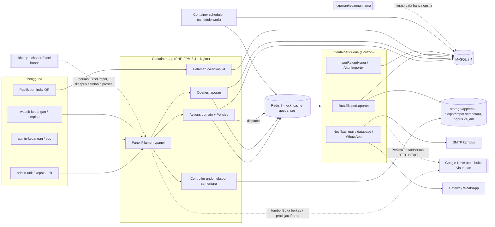

# 02 — Arsitektur Sistem Keuangan Fakultas FKIP Unsil

Dokumen ini adalah turunan `STANDAR-TEKNIS.md` untuk sistem Keuangan. Bila ada pertentangan, `STANDAR-TEKNIS.md` yang berlaku.

## 1. Stack spesifik

| Lapisan | Pilihan | Catatan khusus Keuangan |
|---|---|---|
| Bahasa | PHP 8.4 | Ekstensi wajib: `bcmath` (dipakai `brick/math` bila tersedia), `intl` (format rupiah & tanggal), `gd` (dompdf/QR), `redis` (phpredis) |
| Framework | Laravel `^13.0` | Locale `id`, zona waktu `Asia/Jakarta` |
| Panel | Filament `^5.0` (Livewire 4) | Satu panel `keuangan` di path `/panel` untuk semua peran internal |
| Halaman publik | Blade + Livewire 4 + Tailwind CSS 4 | Hanya `/verifikasi/{id}` dan `/api/health` |
| Basis data | MySQL 8.4 LTS, `utf8mb4_0900_ai_ci`, InnoDB | Uji memakai MySQL (DB `keuangan_testing` di MySQL host), bukan SQLite, agar perilaku `DECIMAL`, `lockForUpdate()`, dan FK sama dengan produksi |
| Redis | 7.x | DB 32 default/lock, DB 33 cache, DB 34 queue |
| Antrean | Redis + Horizon | Antrean: `default`, `notifikasi`, `ekspor`, `impor` |
| PDF | `barryvdh/laravel-dompdf` | Lembar pengajuan + RAB, kartu kegiatan, laporan. Gotenberg tidak diperlukan |
| Excel | Filament Import/Export Action + `spatie/simple-excel` | Ekspor laporan besar lewat Job kustom |
| QR | `endroid/qr-code` | Isi = `https://<domain>/verifikasi/{id}`; dibangkitkan on-the-fly |
| Berkas | **Tautan, bukan unggahan** (STANDAR-TEKNIS §1a) | `BERKAS_MODE=tautan`; tabel polimorfik `tautan_berkas`; rule `TautanBerkasValid`; job `PeriksaTautanBerkas`; kontrak `App\Contracts\PenyimpananBerkas` dengan implementasi aktif `TautanEksternal`. Server tidak menyimpan berkas pengguna |

## 2. Paket Composer/NPM

| Paket | Jenis | Alasan |
|---|---|---|
| `laravel/framework:^13.0` | prod | Kerangka |
| `filament/filament:^5.0` | prod | Panel back-office, tabel, form, impor/ekspor, notifikasi database, MFA |
| `spatie/laravel-permission` | prod | Peran & permission `<modul>.<aksi>` |
| `spatie/laravel-activitylog` | prod | Jejak audit perubahan nilai |
| `laravel/horizon` | prod | Monitor antrean `/horizon` (hanya `super-admin`) |
| `brick/math` | prod | Aritmetika desimal presisi untuk uang (BR-01); biasanya sudah terpasang sebagai dependensi, dinyatakan eksplisit di `composer.json` |
| `barryvdh/laravel-dompdf` | prod | PDF |
| `spatie/simple-excel` | prod | Baca/tulis Excel/CSV besar secara streaming (impor rekap honor, ekspor laporan) |
| `endroid/qr-code` | prod | QR verifikasi lembar pengajuan |
| `pestphp/pest:^4.0`, `pestphp/pest-plugin-laravel` | dev | Uji |
| `larastan/larastan` | dev | Analisis statis level 6 |
| `laravel/pint` | dev | Format kode |
| `laravel/boost` | dev | MCP server + pedoman versi untuk agen AI |
| — (tanpa Sail) | dev | Lingkungan lokal = Docker FKIP (STANDAR-TEKNIS §2) |
| `tailwindcss@4`, `@tailwindcss/vite`, `vite` | npm | Tema Filament kustom & halaman publik |

Yang **tidak** dipakai (sengaja): Meilisearch (pencarian cukup `LIKE`/FULLTEXT pada judul kegiatan), MinIO (tidak ada unggahan berkas — STANDAR-TEKNIS §1a; baru relevan bila kebijakan itu dicabut), Google Drive API/OAuth (pemeriksaan tautan cukup HTTP tanpa login), Reverb (notifikasi database Filament dengan polling 30 detik sudah cukup), Gotenberg.

## 3. Pemakaian Redis

### 3.1 Atomic lock (`Cache::lock()` pada store `redis`, dipadukan `DB::transaction()` + `lockForUpdate()`)

| Kunci lock | TTL | Dipakai di | Tujuan |
|---|---|---|---|
| `lock:penomoran:pengajuan:{tahun}` | 10 dtk (tunggu `block(5)`) | `App\Actions\Pengajuan\AjukanPengajuan` → `App\Support\Penomoran` | Nomor pengajuan unik & berurutan (BR-05) |
| `lock:penomoran:spj:{tahun}` | 10 dtk | `AjukanSpj` | Nomor SPJ unik |
| `lock:aksi:pengajuan:{id}` | 15 dtk | `AjukanPengajuan`, `VerifikasiPengajuan`, `SetujuiPengajuan`, `KembalikanPengajuan`, `TolakPengajuan`, `BatalkanPengajuan` | Cegah dobel klik/aksi ganda (BR-09) |
| `lock:aksi:rab:{id}` | 15 dtk | `AjukanRevisiRab`, `VerifikasiRevisiRab`, `SetujuiRevisiRab` | Idem untuk revisi |
| `lock:aksi:pengajuan-dana:{pengajuan_id}` | 15 dtk | `CatatPencairan`, `BatalkanPencairan`, `CatatRealisasi`, `CatatPengembalian` | Serialisasi semua penulisan yang mengubah total pengajuan (BR-12, BR-14, BR-26) |
| `lock:aksi:spj:{id}` | 15 dtk | `AjukanSpj`, `TerimaSpj` (termasuk `BekukanTautanSpj`), `KembalikanSpj` | BR-09, BR-17 |
| `lock:aksi:pengembalian:{id}` | 15 dtk | `VerifikasiPengembalian`, `TolakPengembalian` | BR-09 |
| `lock:pagu:{tahun}:{unit_id}` | 15 dtk | `AjukanPengajuan`, `SetujuiPengajuan`, `SetujuiRevisiRab` | Cek sisa pagu bebas balapan antar-pengajuan unit yang sama (BR-04) |
| `lock:periode:{id}` | 30 dtk | `KunciPeriode`, `BukaKunciPeriode` | Snapshot rekap konsisten |

Pola standar di semua Action (dibungkus helper `App\Support\DenganKunci::jalankan(string $kunci, Closure $fn)` yang melempar `AksiSedangDiprosesException` bila lock gagal diperoleh):

```php
return DenganKunci::jalankan("aksi:pengajuan:{$pengajuan->id}", function () use ($pengajuan, $pengguna, $catatan) {
    return DB::transaction(function () use ($pengajuan, $pengguna, $catatan) {
        $pengajuan = Pengajuan::whereKey($pengajuan->id)->lockForUpdate()->firstOrFail();
        // cek ulang status, otorisasi, pemisahan tugas, pagu ...
        // ubah status + CatatRiwayatStatus dalam transaksi yang sama
    });
});
```

### 3.2 Cache (store `redis`, DB 33)

| Kunci | TTL | Invalidasi |
|---|---|---|
| `master:unit:aktif` | 24 jam | Observer `Unit` saved/deleted |
| `master:akun:aktif` | 24 jam | Observer `Akun`, selesai impor akun |
| `master:jenis-pencairan:aktif` | 24 jam | Observer |
| `master:tarif-pajak:{jenis}:{tanggal}` | 24 jam | Observer `TarifPajak` → hapus pola via versi |
| `pengaturan:semua` | 24 jam | `App\Support\Pengaturan::set()` |
| `dasbor:v{versi}:{tahun_id}:{unit_id atau semua}:{periode atau tahun}` | 10 menit | Kunci `dasbor:versi` di-`increment` oleh `HitungUlangTotalPengajuan`, `KunciPeriode`, impor honor (cache versi lama kedaluwarsa sendiri) |
| `laporan:lra:v{versi}:{hash parameter}` | 10 menit | Sama dengan dasbor |

### 3.3 Antrean (Redis DB 34, dipantau Horizon)

| Antrean | Job / Notification | Catatan |
|---|---|---|
| `notifikasi` | Semua `Notification` (`ShouldQueue`) — mail, database, WhatsApp | `tries=3`, `backoff=[60,300,900]` |
| `ekspor` | `App\Jobs\BuatEksporLaporan` | `timeout=600`; hasil disimpan **sementara** di `storage/app/tmp/ekspor/`, dihapus ≤ 24 jam |
| `impor` | Filament `AkunImporter`, `UnitImporter`, `App\Jobs\ImporRekapHonor` | Berkas Excel/CSV impor disimpan sementara di `storage/app/tmp/impor/`, diproses, lalu **dihapus** (job `finally`); baris gagal dicatat |
| `default` | `App\Jobs\PeriksaTautanBerkas` (HTTP HEAD/GET tanpa unduh isi, timeout 10 dtk, tanpa cookie/login), `App\Jobs\SimpanSnapshotPeriode` | `PeriksaTautanBerkas` dibatasi `RateLimited('periksa-tautan')` |

Konfigurasi Horizon: supervisor `supervisor-1` antrean `notifikasi,default` (2 proses), `supervisor-ekspor` antrean `ekspor,impor` (1 proses, memori 512 MB).

### 3.4 Rate limit (`RateLimiter::for` di `AppServiceProvider`)

| Nama | Batas | Kunci |
|---|---|---|
| `login` | 5/menit | email + IP |
| `simpan-tautan` | 30/menit | user id |
| `periksa-tautan` | 60/menit | global (permintaan HTTP keluar ke Drive) |
| `ekspor` | 5/menit | user id |
| `verifikasi-publik` | 30/menit | IP |
| `aksi-persetujuan` | 30/menit | user id (cadangan selain lock) |

### 3.5 Sesi
`SESSION_DRIVER=redis` (DB 32 dengan prefix sesi), siap *scale-out*.

## 4. Layanan opsional

Tidak ada layanan opsional yang diwajibkan. Bila kelak kebijakan tautan (STANDAR-TEKNIS §1a) dicabut, tambahkan implementasi `DiskLokal`/`S3` (MinIO) untuk `App\Contracts\PenyimpananBerkas` dan ubah `BERKAS_MODE` — modul lain tidak berubah.

## 5. Struktur folder `app/`

```text
app/
├── Actions/
│   ├── Master/            BuatTahunAnggaran, TetapkanPagu
│   ├── Pengajuan/         SimpanDrafPengajuan, HitungTotalRab, AjukanPengajuan, BatalkanPengajuan,
│   │                      HitungUlangTotalPengajuan, HitungSisaPagu
│   ├── Persetujuan/       VerifikasiPengajuan, SetujuiPengajuan, KembalikanPengajuan, TolakPengajuan
│   ├── Revisi/            BuatRevisiRab, AjukanRevisiRab, VerifikasiRevisiRab, SetujuiRevisiRab,
│   │                      KembalikanRevisiRab, TolakRevisiRab
│   ├── Pencairan/         CatatPencairan, BatalkanPencairan
│   ├── Spj/               CatatRealisasi, HapusRealisasi, CatatPotonganPajak, AjukanSpj, TerimaSpj, KembalikanSpj,
│   │                      BekukanTautanSpj
│   ├── Pengembalian/      CatatPengembalian, VerifikasiPengembalian, TolakPengembalian, SelesaikanPengajuan
│   ├── Periode/           KunciPeriode, BukaKunciPeriode
│   ├── Berkas/            SimpanTautanBerkas, HapusTautanBerkas
│   └── Audit/             CatatRiwayatStatus
├── Contracts/             PenyimpananBerkas
├── Concerns/              MemilikiRiwayatStatus, MenjagaPeriodeTerkunci, MemilikiTautanBerkas, DibatasiUnit
├── Console/Commands/      KirimPengingatSpj, RekonsiliasiTotal, BersihkanBerkasSementara, KirimRekapMingguan,
│                          PeriksaUlangTautan
├── Enums/                 StatusTahunAnggaran, StatusPeriode, StatusPagu, StatusPengajuan, StatusRab,
│                          StatusPencairan, StatusSpj, StatusPengembalian, StatusEkspor, JenisUnit,
│                          JenisTautan, PenyediaTautan, StatusCekTautan, TahapPersetujuan, Peran
├── Exceptions/            AksiSedangDiprosesException, PeriodeTerkunciException, PaguTidakCukupException,
│                          PelanggaranPemisahanTugasException, TransisiStatusTidakSahException
├── Filament/
│   ├── Pages/             Dasbor, Pengaturan, MenungguTindakan, Laporan
│   ├── Resources/         (lihat §6)
│   └── Widgets/           RingkasanPaguWidget, SerapanPerUnitChart, TrenRealisasiBulananChart,
│                          SpjJatuhTempoWidget, AntreanPersetujuanWidget
├── Http/Controllers/      UnduhEksporController, VerifikasiPublikController, HealthController
├── Jobs/                  BuatEksporLaporan, ImporRekapHonor, SimpanSnapshotPeriode, PeriksaTautanBerkas
├── Models/                (lihat 03-SKEMA-DATABASE.md)
├── Notifications/         (lihat §9) + Channels/WhatsAppChannel
├── Policies/              satu Policy per model transaksi & master
├── Queries/               LaporanRealisasiQuery, RekapPajakQuery, SpjTerlambatQuery, PenggunaanDanaQuery
├── Rules/                 TautanBerkasValid
├── Services/Berkas/       TautanEksternal (implements PenyimpananBerkas), PenguraiTautanDrive
└── Support/               Uang (format & BigDecimal), Penomoran, DenganKunci, Pengaturan, VersiCacheDasbor
```

## 6. Panel Filament & Resource

Panel tunggal `keuangan` (`/panel`), login bawaan Filament + MFA (aplikasi autentikator) wajib untuk peran keuangan. Navigasi disembunyikan otomatis lewat Policy `viewAny`.

| Grup navigasi | Resource / Page | Peran utama |
|---|---|---|
| Beranda | `Dasbor` (widget), `MenungguTindakan` (antrean persetujuan/verifikasi milik pengguna) | semua |
| Kegiatan | `PengajuanResource` (form + Repeater RAB, RelationManager: `RabRelationManager` (versi), `PencairanRelationManager`, `TautanBerkasRelationManager` (TOR/KAK & tautan pendukung), `RiwayatStatusRelationManager`, `ActivitiesRelationManager`) | admin-unit, penyetuju |
| Kegiatan | `RevisiRabResource` (daftar revisi lintas pengajuan untuk verifikator) | admin-keuangan, wadek |
| Kegiatan | `SpjResource` (RelationManager `RealisasiItemRelationManager` dengan tautan bukti + pratinjau Drive & pajak; tab "Tautan dibekukan") | admin-unit, bpp, admin-keuangan |
| Bendahara | `PencairanResource`, `PengembalianResource` | bpp |
| Anggaran | `PaguResource` (RelationManager `PaguAkunRelationManager`), `TahunAnggaranResource` (RelationManager `PeriodeRelationManager` dengan aksi Kunci/Buka) | admin-keuangan, wadek |
| Master | `UnitResource`, `AkunResource` (Import action), `KategoriPenggunaanDanaResource`, `JenisPencairanResource`, `JenisPajakResource` (RelationManager `TarifPajakRelationManager`) | admin-keuangan |
| Laporan | `Laporan` (page: pilih jenis, periode, unit, format → antre), `LaporanEksporResource` (riwayat ekspor milik pengguna), `RekapHonorEksternalResource` | admin-keuangan, pimpinan |
| Sistem | `UserResource`, `Pengaturan` (page), tautan Horizon | super-admin, admin-keuangan |

Aturan Resource: setiap Resource wajib Policy; Resource yang bercakupan unit menimpa `getEloquentQuery()` dengan scope `DibatasiUnit` (BR-21); route record memakai `id` UUIDv7 (route key bawaan); tombol aksi status adalah `Action` Filament yang memanggil kelas `App\Actions\…` dan menangani exception domain sebagai notifikasi Filament.

## 7. Halaman publik & endpoint

| Route | Nama | Keterangan |
|---|---|---|
| `GET /` | — | Redirect ke `/panel` |
| `GET /verifikasi/{id}` | `verifikasi.pengajuan` | Livewire/Blade; menampilkan nomor, unit, judul, status, total disetujui, tanggal persetujuan; rate limit `verifikasi-publik`; tanpa rincian item/penerima |
| `GET /ekspor/{id}` | `ekspor.unduh` | *Signed URL* (≤ 24 jam) + auth pemilik; berkas sementara dari `storage/app/tmp` |

Tidak ada route unggah/unduh berkas pengguna: tautan bukti dibuka langsung ke Drive (`target="_blank" rel="noopener noreferrer"`) hanya bila Policy pemiliknya mengizinkan.
| `GET /api/health` | `health` | JSON `{status, db, redis, versi}` |
| `/horizon` | — | Gate `viewHorizon` = `super-admin` |

## 8. Job & penjadwal (`routes/console.php`)

| Jadwal (Asia/Jakarta) | Perintah/Job | Fungsi |
|---|---|---|
| Setiap hari 07.00 | `keuangan:pengingat-spj` | Kirim pengingat H-3 dan H-0 batas SPJ; pengingat terlambat setiap 3 hari ke admin-unit + kepala-unit; tembusan admin-keuangan |
| Setiap Senin 07.30 | `keuangan:rekap-mingguan` | Ringkasan ke admin-keuangan, bpp, wadek: antrean persetujuan, SPJ terlambat, pengembalian menunggu |
| Tanggal 5 setiap bulan 08.00 | `keuangan:pengingat-kunci-periode` | Mengingatkan admin-keuangan mengunci periode bulan lalu |
| Setiap jam (menit 15) | `keuangan:bersihkan-sementara` | Hapus berkas di `storage/app/tmp` (ekspor & impor) berumur > 24 jam; tandai `laporan_ekspor` kedaluwarsa |
| Setiap Minggu 03.00 | `keuangan:periksa-ulang-tautan` | Dispatch `PeriksaTautanBerkas` untuk tautan aktif (bukan yang sudah dibekukan) yang `dicek_pada` > 7 hari; notifikasi pemilik bila tidak dapat diakses atau berindikasi publik |
| Setiap hari 01.00 | `keuangan:rekonsiliasi` | Bandingkan kolom total denormalisasi vs perhitungan ulang; laporkan selisih ke super-admin (BR-26) |
| Setiap 5 menit | `horizon:snapshot` | Metrik Horizon |

Semua perintah memakai `->withoutOverlapping()->onOneServer()`.

## 9. Notifikasi

Kanal: `database` (lonceng Filament), `mail` (SMTP kampus; Mailpit di lokal), `whatsapp` (opsional; `App\Notifications\Channels\WhatsAppChannel` memanggil gateway HTTP, mis. Fonnte; aktif bila `WHATSAPP_AKTIF=true` dan pengguna punya `no_hp`). Semua `ShouldQueue` di antrean `notifikasi`.

| Notification | Pemicu | Penerima |
|---|---|---|
| `PengajuanMenungguTindakan` | Pengajuan masuk tahap berikutnya | Pemegang peran tahap tsb (kepala-unit unit terkait / semua admin-keuangan / wadek-keuangan) |
| `PengajuanDikembalikan` / `PengajuanDitolak` | Kembalikan/tolak | Pembuat pengajuan + admin-unit unit |
| `PengajuanDisetujui` | Persetujuan akhir | Admin-unit, kepala-unit, bpp |
| `RevisiRabMenungguTindakan`, `RevisiRabDiputuskan` | Alur revisi | Sesuai tahap / pembuat |
| `PencairanDicatat` | Pencairan baru | Admin-unit, kepala-unit (berisi batas SPJ) |
| `PengingatBatasSpj` | Penjadwal | Admin-unit, kepala-unit; tembusan admin-keuangan bila terlambat |
| `SpjMenungguVerifikasi`, `SpjDiputuskan` | Alur SPJ | bpp & admin-keuangan / pembuat |
| `PengembalianMenungguVerifikasi`, `PengajuanSelesai` | Alur pengembalian | bpp / admin-unit |
| `PeriodeDikunci`, `PeriodeDibukaKembali` | Kunci/buka | Semua peran keuangan |
| `EksporSiap`, `EksporGagal` | Job ekspor | Peminta |
| `IndikasiBuktiGanda` | `drive_file_id`/URL bukti sama dengan pengajuan lain | admin-keuangan, bpp |
| `TautanBerkasBermasalah` | `PeriksaTautanBerkas`: tidak dapat diakses, atau bukti keuangan dapat dibuka anonim (`peringatan_privasi`) | Penambah tautan (`ditambahkan_oleh`) + admin-unit unit terkait |

## 10. Strategi berkas: tautan, bukan unggahan

Mengikuti STANDAR-TEKNIS §1a (keputusan 6 Oktober 2026: storage server terbatas).

- **Tidak ada `FileUpload`/`<input type="file">`** kecuali untuk impor Excel/CSV (akun, unit, rekap honor fkipapp, impor historis) yang disimpan sementara di `storage/app/tmp/impor/`, diproses, lalu dihapus.
- Semua lampiran/bukti = baris `tautan_berkas` (polimorfik, `morphMany` lewat trait `MemilikiTautanBerkas`) pada `pengajuan` (TOR/KAK, surat tugas), `pencairan` (bukti transfer/kuitansi), `realisasi_item` (kuitansi, nota, faktur, daftar hadir, foto kegiatan), `pengembalian` (bukti setor). Satu realisasi boleh punya banyak tautan.
- `App\Rules\TautanBerkasValid`: `https://` saja; domain dalam `config/berkas.php` (`drive.google.com`, `docs.google.com`, `*.unsil.ac.id`, opsional `onedrive.live.com`, `*.sharepoint.com`); tolak pemendek URL (bit.ly, s.id, tinyurl, dst.) dan tautan folder Drive (`/drive/folders/`); `PenguraiTautanDrive` mengekstrak `drive_file_id` dari pola `/file/d/<id>`, `open?id=<id>`, `/document/d/<id>`, `/spreadsheets/d/<id>`.
- **Privasi bukti keuangan**: kuitansi/nota/faktur/bukti transfer/bukti setor memuat NPWP dan nomor rekening → formulir menampilkan petunjuk "Bagikan: Terbatas — Universitas Siliwangi (unsil.ac.id)" dan mewajibkan centang `akses_terbatas_dikonfirmasi`. `PeriksaTautanBerkas` meminta URL **tanpa cookie**; bila berkas bukti keuangan bisa dibuka anonim (HTTP 200 tanpa halaman login Google), set `peringatan_privasi = true` dan kirim `TautanBerkasBermasalah`. Hasil cek bersifat informatif dan tidak memblokir simpan (Drive kadang meminta login).
- **Duplikasi**: `drive_file_id` (atau URL ternormalisasi) yang sama pada realisasi pengajuan lain → `realisasi_item.indikasi_bukti_ganda = true` + event `IndikasiBuktiGandaTerdeteksi`.
- **Tampilan**: tombol "Buka berkas" (`target="_blank" rel="noopener noreferrer"`); pratinjau PDF via iframe `https://drive.google.com/file/d/<id>/preview` (akan meminta login akun unsil.ac.id bila akses terbatas — itu yang diharapkan); foto via `https://lh3.googleusercontent.com/d/<id>`; placeholder bila gagal dimuat. CSP mengizinkan `frame-src drive.google.com docs.google.com` dan `img-src lh3.googleusercontent.com`.
- **Pembekuan**: `AjukanSpj` mewajibkan pernyataan berkas final; `TerimaSpj` memanggil `BekukanTautanSpj` yang menyalin semua tautan aktif (realisasi, pencairan, TOR) ke `tautan_berkas_beku` dengan `riwayat_status_id` penerimaan. Setelah itu `tautan_berkas` milik realisasi tersebut terkunci (guard model). Perubahan tautan sebelum itu tercatat activitylog (URL lama → baru).
- **Keluaran sistem** (PDF lembar pengajuan, kartu kegiatan, laporan, ekspor Excel) di-*stream* langsung ke browser; ekspor besar lewat antrean ditulis ke `storage/app/tmp/ekspor/` dan dihapus ≤ 24 jam. QR dibangkitkan on-the-fly.
- **Kontrak**: seluruh akses berkas lewat `App\Contracts\PenyimpananBerkas` (`simpan(Model $pemilik, JenisTautan $jenis, string $url, ...)`, `urlTampil(TautanBerkas)`, `urlPratinjau(TautanBerkas)`, `periksa(TautanBerkas)`), implementasi aktif `TautanEksternal`, dipilih dari `config('berkas.mode')` = env `BERKAS_MODE=tautan`.
- **Cadangan**: server hanya mencadangkan MySQL. Unit disarankan menyimpan bukti di **Shared Drive fakultas/unit** (bukan Drive pribadi) agar tidak hilang saat pegawai pindah/purnatugas.

## 11. Diagram komponen


