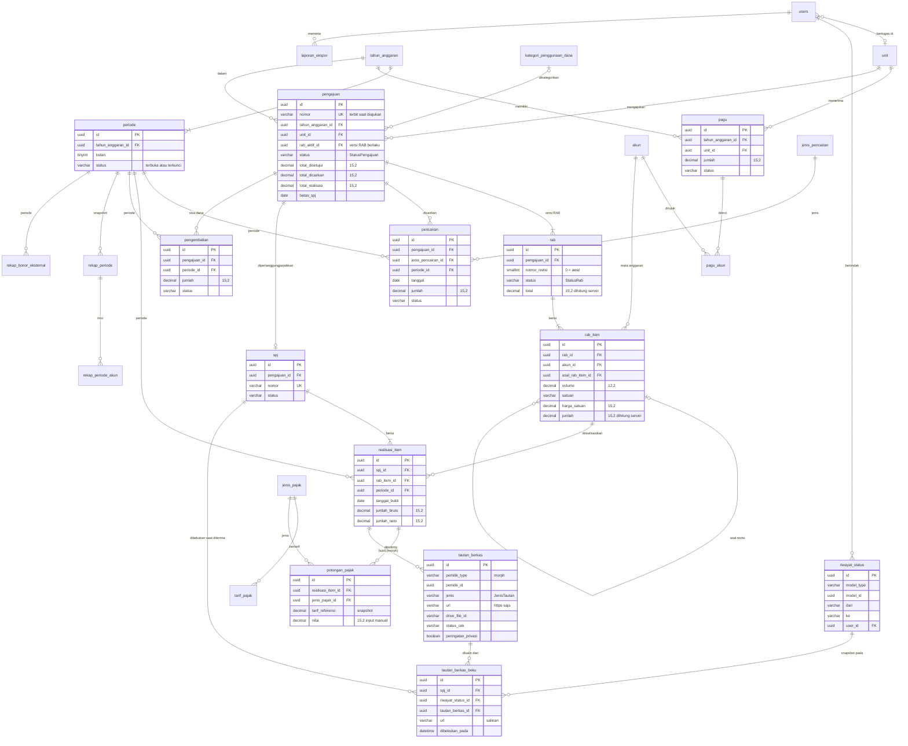

# 03 — Skema Basis Data Sistem Keuangan FKIP Unsil

Konvensi (dari `STANDAR-TEKNIS.md` §4):
- MySQL 8.4, InnoDB, `utf8mb4_0900_ai_ci`. Nama tabel/kolom bahasa Indonesia, `snake_case`, **bentuk tunggal** (`pengajuan`, bukan `pengajuans`) — setiap model wajib menyetel `protected $table`.
- Semua primary key `id` **UUIDv7** CHAR(36) (`HasUuids`, STANDAR-TEKNIS §4a); FK `foreignUuid`, polimorfik `uuidMorphs`; URL, QR, dan API memakai `id` yang sama (tanpa kolom `ulid`).
- Uang `DECIMAL(15,2)` (BR-01), volume `DECIMAL(12,2)`, persentase `DECIMAL(5,2)`.
- Kolom `status` disimpan `VARCHAR(30)` dan di-*cast* ke PHP Enum (bukan tipe `ENUM` MySQL, agar penambahan nilai tidak memerlukan `ALTER` berisiko).
- FK bawaan `restrictOnDelete()` kecuali disebut lain. Soft delete (`deleted_at`) hanya untuk master dan draf.
- Kolom `*_oleh` → FK `users.id`; `*_pada` → `DATETIME`.
- **Tidak ada kolom path/ukuran/hash berkas**: server tidak menyimpan berkas pengguna (STANDAR-TEKNIS §1a). Lampiran & bukti disimpan sebagai tautan di `tautan_berkas`; impor Excel diproses dari `storage/app/tmp` lalu dihapus.

## 1. ERD

Tabel polimorfik `tautan_berkas` (tautan TOR/KAK, surat tugas, bukti pencairan, kuitansi/nota/faktur, daftar hadir, foto kegiatan, bukti setor) dan `riwayat_status` terhubung ke banyak tabel (`pengajuan`, `pencairan`, `realisasi_item`, `pengembalian`) sehingga tidak semua relasinya digambar.

## 2. Tabel per tabel

### 2.1 Pengguna & sistem

#### `users` (bawaan Laravel, ditambah kolom)
| Kolom | Tipe | Null | Default | Indeks/FK | Keterangan |
|---|---|---|---|---|---|
| id | CHAR(36) UUIDv7 | tidak |  | PK | |
| name | VARCHAR(150) | tidak | | | Nama lengkap + gelar |
| email | VARCHAR(255) | tidak | | UNIQUE | Akun `@unsil.ac.id` |
| email_verified_at | DATETIME | ya | | | |
| password | VARCHAR(255) | tidak | | | |
| nip | VARCHAR(30) | ya | | INDEX | NIP/NIDN/NIPPPK |
| no_hp | VARCHAR(20) | ya | | | Untuk WhatsApp (data pribadi) |
| unit_id | CHAR(36) | ya | | FK `unit.id` nullOnDelete | Wajib untuk `admin-unit`, `kepala-unit` |
| kode_eksternal | VARCHAR(50) | ya | | INDEX | Pemetaan ke data SDM/FKIP Edu |
| aktif | BOOLEAN | tidak | 1 | | Akun nonaktif tidak bisa login |
| app_authentication_secret | TEXT | ya | | | MFA Filament (terenkripsi) |
| app_authentication_recovery_codes | TEXT | ya | | | MFA Filament (terenkripsi) |
| remember_token | VARCHAR(100) | ya | | | |
| created_at, updated_at | DATETIME | ya | | | |

#### `riwayat_status`
| Kolom | Tipe | Null | Default | Indeks/FK | Keterangan |
|---|---|---|---|---|---|
| id | CHAR(36) UUIDv7 | tidak |  | PK | |
| model_type | VARCHAR(100) | tidak | | INDEX(model_type, model_id, created_at) | Morph alias: `pengajuan`, `rab`, `pencairan`, `spj`, `pengembalian`, `periode`, `pagu` |
| model_id | CHAR(36) | tidak | | | |
| dari | VARCHAR(30) | ya | | | Null untuk status awal |
| ke | VARCHAR(30) | tidak | | | |
| tahap | VARCHAR(30) | ya | | | `TahapPersetujuan`: `kepala_unit`, `keuangan`, `wadek`, `bendahara` (dipakai pemeriksaan BR-07) |
| catatan | TEXT | ya | | | Wajib untuk kembalikan/tolak/batal/buka kunci |
| user_id | CHAR(36) | ya | | FK `users.id`, INDEX | Null = sistem/penjadwal |
| created_at | DATETIME | tidak | CURRENT_TIMESTAMP | | Tidak ada `updated_at`; baris tidak pernah diubah |

#### `pengaturan`
| Kolom | Tipe | Null | Default | Indeks/FK | Keterangan |
|---|---|---|---|---|---|
| id | CHAR(36) UUIDv7 | tidak |  | PK | |
| kunci | VARCHAR(100) | tidak | | UNIQUE | |
| nilai | TEXT | ya | | | |
| tipe | VARCHAR(20) | tidak | `string` | | `string`, `int`, `bool`, `json` |
| keterangan | VARCHAR(255) | ya | | | |
| created_at, updated_at | DATETIME | ya | | | |

#### `penomoran`
| Kolom | Tipe | Null | Default | Indeks/FK | Keterangan |
|---|---|---|---|---|---|
| id | CHAR(36) UUIDv7 | tidak |  | PK | |
| jenis | VARCHAR(30) | tidak | | UNIQUE(jenis, tahun) | `pengajuan`, `spj` |
| tahun | SMALLINT UNSIGNED | tidak | | | |
| nomor_terakhir | INT UNSIGNED | tidak | 0 | | Dinaikkan di bawah lock (BR-05) |
| created_at, updated_at | DATETIME | ya | | | |

#### `tautan_berkas` (polimorfik — STANDAR-TEKNIS §1a, ditambah 2 kolom khusus keuangan)
| Kolom | Tipe | Null | Default | Indeks/FK | Keterangan |
|---|---|---|---|---|---|
| id | CHAR(36) UUIDv7 | tidak |  | PK | |
| pemilik_type | VARCHAR(100) | tidak | | INDEX(pemilik_type, pemilik_id) | Morph alias: `pengajuan`, `pencairan`, `realisasi_item`, `pengembalian` |
| pemilik_id | CHAR(36) | tidak | | | |
| jenis | VARCHAR(30) | tidak | | INDEX | `JenisTautan` (lihat §3) |
| label | VARCHAR(150) | tidak | | | Mis. "Kuitansi konsumsi 12 Mei" |
| url | VARCHAR(2048) | tidak | | | Hanya `https://`, domain daftar putih (`TautanBerkasValid`) |
| penyedia | ENUM(`google_drive`,`google_docs`,`onedrive`,`unsil`,`lainnya`) | tidak | | | Sesuai standar §1a |
| drive_file_id | VARCHAR(100) | ya | | INDEX | Diekstrak dari URL Drive; dipakai pratinjau & deteksi bukti ganda |
| status_cek | ENUM(`belum`,`dapat_diakses`,`tidak_dapat_diakses`) | tidak | `belum` | INDEX | Hasil `PeriksaTautanBerkas` (informatif) |
| dicek_pada | DATETIME | ya | | | |
| akses_terbatas_dikonfirmasi | BOOLEAN | tidak | 0 | | **Khusus keuangan**: pengguna menyatakan berkas dibagikan terbatas ke domain unsil.ac.id; wajib `true` untuk jenis bukti keuangan (BR-15) |
| peringatan_privasi | BOOLEAN | tidak | 0 | | **Khusus keuangan**: diset job bila bukti keuangan dapat dibuka anonim (tampaknya dibagikan publik) |
| ditambahkan_oleh | CHAR(36) | tidak | | FK `users.id` | |
| created_at, updated_at, deleted_at | DATETIME | ya | | | Soft delete hanya selama pemilik masih dapat diubah; tidak dapat diubah/dihapus setelah dibekukan |

#### `tautan_berkas_beku` (snapshot saat SPJ diterima — BR-17)
| Kolom | Tipe | Null | Default | Indeks/FK | Keterangan |
|---|---|---|---|---|---|
| id | CHAR(36) UUIDv7 | tidak |  | PK | |
| spj_id | CHAR(36) | tidak | | FK `spj.id`, INDEX | |
| riwayat_status_id | CHAR(36) | tidak | | FK `riwayat_status.id` | Baris riwayat transisi `diajukan → diterima` |
| tautan_berkas_id | CHAR(36) | tidak | | FK `tautan_berkas.id` | Sumber salinan |
| pemilik_type | VARCHAR(100) | tidak | | | Salinan |
| pemilik_id | CHAR(36) | tidak | | | Salinan |
| jenis | VARCHAR(30) | tidak | | | Salinan |
| label | VARCHAR(150) | tidak | | | Salinan |
| url | VARCHAR(2048) | tidak | | | Salinan URL pada saat diterima |
| drive_file_id | VARCHAR(100) | ya | | | Salinan |
| status_cek | VARCHAR(30) | tidak | | | Salinan status terakhir |
| dicek_pada | DATETIME | ya | | | Salinan |
| dibekukan_pada | DATETIME | tidak | | | Waktu penerimaan SPJ |
| created_at | DATETIME | tidak | | | Baris tidak pernah diubah/dihapus (tanpa `updated_at`) |

#### `laporan_ekspor`
| Kolom | Tipe | Null | Default | Indeks/FK | Keterangan |
|---|---|---|---|---|---|
| id | CHAR(36) UUIDv7 | tidak |  | PK | |
| jenis | VARCHAR(30) | tidak | | | `LAP-01` … `LAP-09` |
| parameter | JSON | tidak | | | Tahun, periode/semester, unit, akun |
| format | VARCHAR(5) | tidak | | | `xlsx`, `pdf` |
| status | VARCHAR(20) | tidak | `antre` | INDEX | `StatusEkspor` |
| path | VARCHAR(255) | ya | | | Berkas **sementara** di `storage/app/tmp/ekspor/`; dikosongkan saat dihapus (≤ 24 jam) |
| ukuran_byte | INT UNSIGNED | ya | | | |
| diminta_oleh | CHAR(36) | tidak | | FK `users.id`, INDEX | |
| mulai_pada, selesai_pada, kedaluwarsa_pada | DATETIME | ya | | | |
| pesan_galat | TEXT | ya | | | |
| created_at, updated_at | DATETIME | ya | | | |

### 2.2 Master

#### `tahun_anggaran`
| Kolom | Tipe | Null | Default | Indeks/FK | Keterangan |
|---|---|---|---|---|---|
| id | CHAR(36) UUIDv7 | tidak |  | PK | |
| tahun | SMALLINT UNSIGNED | tidak | | UNIQUE | |
| nama | VARCHAR(50) | tidak | | | "Tahun Anggaran 2027" |
| tanggal_mulai | DATE | tidak | | | Bawaan 1 Januari |
| tanggal_selesai | DATE | tidak | | | Bawaan 31 Desember |
| status | VARCHAR(20) | tidak | `perencanaan` | INDEX | `StatusTahunAnggaran` (BR-20) |
| keterangan | TEXT | ya | | | |
| created_at, updated_at, deleted_at | DATETIME | ya | | | |

#### `periode`
| Kolom | Tipe | Null | Default | Indeks/FK | Keterangan |
|---|---|---|---|---|---|
| id | CHAR(36) UUIDv7 | tidak |  | PK | |
| tahun_anggaran_id | CHAR(36) | tidak | | FK, UNIQUE(tahun_anggaran_id, bulan) | |
| bulan | TINYINT UNSIGNED | tidak | | | 1–12 |
| nama | VARCHAR(30) | tidak | | | "Januari 2027" |
| tanggal_mulai | DATE | tidak | | INDEX(tanggal_mulai, tanggal_selesai) | |
| tanggal_selesai | DATE | tidak | | | |
| status | VARCHAR(20) | tidak | `terbuka` | | `StatusPeriode` (BR-19) |
| dikunci_oleh | CHAR(36) | ya | | FK `users.id` | |
| dikunci_pada | DATETIME | ya | | | |
| versi_kunci | SMALLINT UNSIGNED | tidak | 0 | | Bertambah setiap dikunci |
| created_at, updated_at | DATETIME | ya | | | |

Semester laporan = bulan 1–6 dan 7–12 tahun anggaran (**perlu konfirmasi** apakah pimpinan menginginkan semester anggaran atau semester akademik).

#### `unit`
| Kolom | Tipe | Null | Default | Indeks/FK | Keterangan |
|---|---|---|---|---|---|
| id | CHAR(36) UUIDv7 | tidak |  | PK | |
| kode | VARCHAR(20) | tidak | | UNIQUE | Mis. `PMAT`, `LAB-MIPA`, `DEKANAT` |
| nama | VARCHAR(150) | tidak | | | |
| jenis | VARCHAR(30) | tidak | `prodi` | INDEX | `JenisUnit`: `prodi`, `laboratorium`, `unit_pendukung`, `pimpinan`, `lainnya` |
| jenjang | VARCHAR(10) | ya | | | `S1`, `S2`, `PPG`, … |
| kepala_user_id | CHAR(36) | ya | | FK `users.id` nullOnDelete | Kepala unit/Kaprodi |
| kode_eksternal | VARCHAR(50) | ya | | INDEX | |
| aktif | BOOLEAN | tidak | 1 | | |
| created_at, updated_at, deleted_at | DATETIME | ya | | | |

#### `kategori_penggunaan_dana`
| Kolom | Tipe | Null | Default | Indeks/FK | Keterangan |
|---|---|---|---|---|---|
| id | CHAR(36) UUIDv7 | tidak |  | PK | |
| kode | VARCHAR(40) | tidak | | UNIQUE | |
| nama | VARCHAR(150) | tidak | | | |
| urutan | SMALLINT UNSIGNED | tidak | 0 | | Urutan baris LAP-08 |
| aktif | BOOLEAN | tidak | 1 | | |
| created_at, updated_at, deleted_at | DATETIME | ya | | | |

#### `akun` (mata anggaran / BAS)
| Kolom | Tipe | Null | Default | Indeks/FK | Keterangan |
|---|---|---|---|---|---|
| id | CHAR(36) UUIDv7 | tidak |  | PK | |
| kode | VARCHAR(10) | tidak | | UNIQUE | Kode akun BAS (6 digit) |
| nama | VARCHAR(255) | tidak | | FULLTEXT(nama) opsional | |
| kelompok | VARCHAR(10) | ya | | INDEX | Mis. `521`, `522`, `524`, `525` |
| jenis_belanja | VARCHAR(30) | ya | | | `barang`, `modal`, `pegawai`, `lainnya` |
| sumber | VARCHAR(10) | tidak | `impor` | | `impor`, `manual`, `contoh` (data seeder contoh harus diganti) |
| aktif | BOOLEAN | tidak | 1 | | |
| keterangan | VARCHAR(255) | ya | | | |
| created_at, updated_at, deleted_at | DATETIME | ya | | | |

#### `jenis_pencairan`
| Kolom | Tipe | Null | Default | Indeks/FK | Keterangan |
|---|---|---|---|---|---|
| id | CHAR(36) UUIDv7 | tidak |  | PK | |
| kode | VARCHAR(10) | tidak | | UNIQUE | `UP`, `TUP`, `LS` |
| nama | VARCHAR(100) | tidak | | | |
| pola | VARCHAR(10) | tidak | `semua` | | `semua`, `satker`, `blu` (BR-25) |
| keterangan | VARCHAR(255) | ya | | | |
| perlu_verifikasi | BOOLEAN | tidak | 1 | | Tanda istilah belum dikonfirmasi |
| aktif | BOOLEAN | tidak | 1 | | |
| created_at, updated_at, deleted_at | DATETIME | ya | | | |

#### `jenis_pajak` dan `tarif_pajak`
`jenis_pajak`: `id`, `kode` VARCHAR(20) UNIQUE (`pph21`, `pph22`, `pph23`, `pph4_2`, `ppn`), `nama` VARCHAR(100), `aktif` BOOLEAN default 1, timestamps, `deleted_at`.

| Kolom (`tarif_pajak`) | Tipe | Null | Default | Indeks/FK | Keterangan |
|---|---|---|---|---|---|
| id | CHAR(36) UUIDv7 | tidak |  | PK | |
| jenis_pajak_id | CHAR(36) | tidak | | FK, INDEX(jenis_pajak_id, berlaku_mulai) | |
| uraian | VARCHAR(255) | tidak | | | Mis. "Jasa (dengan NPWP)" |
| tarif_persen | DECIMAL(5,2) | tidak | | | Hanya referensi (BR-16) |
| berlaku_mulai | DATE | tidak | | | |
| berlaku_sampai | DATE | ya | | | |
| dasar_hukum | VARCHAR(255) | ya | | | |
| perlu_verifikasi | BOOLEAN | tidak | 1 | | Ditampilkan sebagai lencana |
| aktif | BOOLEAN | tidak | 1 | | |
| created_at, updated_at | DATETIME | ya | | | |

#### `pagu` dan `pagu_akun`
| Kolom (`pagu`) | Tipe | Null | Default | Indeks/FK | Keterangan |
|---|---|---|---|---|---|
| id | CHAR(36) UUIDv7 | tidak |  | PK | |
| tahun_anggaran_id | CHAR(36) | tidak | | FK, UNIQUE(tahun_anggaran_id, unit_id) | |
| unit_id | CHAR(36) | tidak | | FK | |
| jumlah | DECIMAL(15,2) | tidak | 0.00 | | |
| sumber_dana | VARCHAR(100) | ya | | | Teks bebas (mis. PNBP/BLU — istilah perlu verifikasi) |
| status | VARCHAR(20) | tidak | `draf` | | `StatusPagu`: `draf`, `ditetapkan` |
| keterangan | TEXT | ya | | | |
| dibuat_oleh | CHAR(36) | tidak | | FK | |
| ditetapkan_oleh | CHAR(36) | ya | | FK | `wadek-keuangan` |
| ditetapkan_pada | DATETIME | ya | | | |
| created_at, updated_at, deleted_at | DATETIME | ya | | | Hapus hanya saat `draf` |

`pagu_akun`: `id`, `pagu_id` FK (cascadeOnDelete), `akun_id` FK, `jumlah` DECIMAL(15,2), timestamps, UNIQUE(`pagu_id`, `akun_id`). Aturan: Σ `pagu_akun.jumlah` ≤ `pagu.jumlah`.

### 2.3 Transaksi

#### `pengajuan`
| Kolom | Tipe | Null | Default | Indeks/FK | Keterangan |
|---|---|---|---|---|---|
| id | CHAR(36) UUIDv7 | tidak |  | PK | |
| nomor | VARCHAR(40) | ya | | UNIQUE | Terbit saat diajukan (BR-05) |
| tahun_anggaran_id | CHAR(36) | tidak | | FK, INDEX(tahun_anggaran_id, unit_id, status) | |
| unit_id | CHAR(36) | tidak | | FK | |
| kategori_penggunaan_dana_id | CHAR(36) | ya | | FK | Untuk LAP-08 |
| judul_kegiatan | VARCHAR(255) | tidak | | FULLTEXT(judul_kegiatan) | |
| deskripsi | TEXT | ya | | | Latar belakang & tujuan singkat (TOR lengkap sebagai lampiran) |
| tanggal_mulai_kegiatan | DATE | tidak | | | |
| tanggal_selesai_kegiatan | DATE | tidak | | | ≥ tanggal mulai |
| tempat | VARCHAR(255) | ya | | | |
| penanggung_jawab | VARCHAR(150) | tidak | | | |
| rab_aktif_id | CHAR(36) | ya | | FK `rab.id` (ditambahkan setelah tabel `rab`) | |
| status | VARCHAR(30) | tidak | `draf` | INDEX | `StatusPengajuan` |
| wajib_kepala_unit | BOOLEAN | tidak | 1 | | Snapshot pengaturan saat diajukan (BR-06) |
| wajib_wadek | BOOLEAN | tidak | 1 | | Snapshot pengaturan saat diajukan |
| total_diajukan | DECIMAL(15,2) | tidak | 0.00 | | = total RAB versi 0 (BR-26) |
| total_disetujui | DECIMAL(15,2) | tidak | 0.00 | | = total RAB aktif yang disetujui |
| total_dicairkan | DECIMAL(15,2) | tidak | 0.00 | | Σ pencairan `dicatat` |
| total_realisasi | DECIMAL(15,2) | tidak | 0.00 | | Σ realisasi bruto |
| total_pajak | DECIMAL(15,2) | tidak | 0.00 | | Σ potongan pajak (informasi) |
| total_dikembalikan | DECIMAL(15,2) | tidak | 0.00 | | Σ pengembalian `diverifikasi` |
| batas_spj | DATE | ya | | INDEX | BR-13 |
| dibuat_oleh | CHAR(36) | tidak | | FK | |
| diajukan_pada, disetujui_pada, selesai_pada | DATETIME | ya | | | |
| alasan_batal | TEXT | ya | | | |
| created_at, updated_at, deleted_at | DATETIME | ya | | | Soft delete hanya untuk `draf` tanpa nomor |

#### `rab`
| Kolom | Tipe | Null | Default | Indeks/FK | Keterangan |
|---|---|---|---|---|---|
| id | CHAR(36) UUIDv7 | tidak |  | PK | |
| pengajuan_id | CHAR(36) | tidak | | FK, UNIQUE(pengajuan_id, nomor_revisi) | |
| nomor_revisi | SMALLINT UNSIGNED | tidak | 0 | | 0 = RAB awal; 1, 2, … = revisi (BR-10) |
| status | VARCHAR(30) | tidak | `draf` | | `StatusRab` |
| total | DECIMAL(15,2) | tidak | 0.00 | | Σ `rab_item.jumlah` (BR-02) |
| alasan_revisi | TEXT | ya | | | Wajib untuk revisi ≥ 1 |
| dibuat_oleh | CHAR(36) | tidak | | FK | |
| diajukan_pada | DATETIME | ya | | | |
| disetujui_oleh | CHAR(36) | ya | | FK | |
| disetujui_pada | DATETIME | ya | | | |
| created_at, updated_at | DATETIME | ya | | | Tidak pernah dihapus setelah diajukan |

#### `rab_item`
| Kolom | Tipe | Null | Default | Indeks/FK | Keterangan |
|---|---|---|---|---|---|
| id | CHAR(36) UUIDv7 | tidak |  | PK | |
| rab_id | CHAR(36) | tidak | | FK (cascadeOnDelete hanya berlaku saat RAB draf dihapus), INDEX(rab_id, akun_id) | |
| akun_id | CHAR(36) | tidak | | FK | |
| asal_rab_item_id | CHAR(36) | ya | | FK `rab_item.id` | Item asal di versi sebelumnya (BR-11) |
| urutan | SMALLINT UNSIGNED | tidak | 0 | | |
| uraian | VARCHAR(255) | tidak | | | |
| rincian_volume | VARCHAR(100) | ya | | | Mis. "2 org x 3 hr" (informasi) |
| volume | DECIMAL(12,2) | tidak | | | > 0 |
| satuan | VARCHAR(30) | tidak | | | OH, OK, paket, rim, … |
| harga_satuan | DECIMAL(15,2) | tidak | | | ≥ 0 |
| jumlah | DECIMAL(15,2) | tidak | 0.00 | | Dihitung server (BR-02) |
| keterangan | VARCHAR(255) | ya | | | |
| created_at, updated_at | DATETIME | ya | | | |

#### `pencairan`
| Kolom | Tipe | Null | Default | Indeks/FK | Keterangan |
|---|---|---|---|---|---|
| id | CHAR(36) UUIDv7 | tidak |  | PK | |
| pengajuan_id | CHAR(36) | tidak | | FK, INDEX(pengajuan_id, status) | |
| jenis_pencairan_id | CHAR(36) | tidak | | FK | |
| periode_id | CHAR(36) | tidak | | FK, INDEX | Diturunkan dari `tanggal` |
| tanggal | DATE | tidak | | | BR-19 |
| jumlah | DECIMAL(15,2) | tidak | | | > 0, BR-12 |
| nomor_bukti | VARCHAR(100) | tidak | | | Nomor kuitansi/SP2D/transfer (istilah perlu verifikasi) |
| penerima | VARCHAR(150) | ya | | | |
| keterangan | VARCHAR(255) | ya | | | |
| status | VARCHAR(20) | tidak | `dicatat` | | `StatusPencairan` |
| dicatat_oleh | CHAR(36) | tidak | | FK | |
| dibatalkan_oleh | CHAR(36) | ya | | FK | |
| dibatalkan_pada | DATETIME | ya | | | |
| alasan_batal | TEXT | ya | | | |
| created_at, updated_at | DATETIME | ya | | | |

#### `spj`
| Kolom | Tipe | Null | Default | Indeks/FK | Keterangan |
|---|---|---|---|---|---|
| id | CHAR(36) UUIDv7 | tidak |  | PK | |
| pengajuan_id | CHAR(36) | tidak | | FK, UNIQUE | Satu SPJ per pengajuan |
| nomor | VARCHAR(40) | ya | | UNIQUE | Terbit saat diajukan pertama |
| status | VARCHAR(20) | tidak | `draf` | INDEX | `StatusSpj` |
| total_realisasi | DECIMAL(15,2) | tidak | 0.00 | | |
| total_pajak | DECIMAL(15,2) | tidak | 0.00 | | |
| dibuat_oleh | CHAR(36) | tidak | | FK | |
| diajukan_pada | DATETIME | ya | | | |
| pernyataan_final_oleh | CHAR(36) | ya | | FK | Pengaju yang menyatakan berkas di tautan final & dibagikan terbatas (BR-17) |
| pernyataan_final_pada | DATETIME | ya | | | Diisi setiap kali SPJ diajukan (ulang) |
| diputuskan_oleh | CHAR(36) | ya | | FK | |
| diputuskan_pada | DATETIME | ya | | | |
| catatan_verifikasi | TEXT | ya | | | |
| created_at, updated_at | DATETIME | ya | | | |

#### `realisasi_item`
| Kolom | Tipe | Null | Default | Indeks/FK | Keterangan |
|---|---|---|---|---|---|
| id | CHAR(36) UUIDv7 | tidak |  | PK | |
| spj_id | CHAR(36) | tidak | | FK, INDEX | |
| rab_item_id | CHAR(36) | tidak | | FK, INDEX | Selalu menunjuk item versi RAB aktif (BR-11) |
| periode_id | CHAR(36) | tidak | | FK, INDEX | Dari `tanggal_bukti` |
| tanggal_bukti | DATE | tidak | | | BR-19 |
| nomor_bukti | VARCHAR(100) | tidak | | | Nomor kuitansi/nota |
| uraian | VARCHAR(255) | tidak | | | |
| penerima | VARCHAR(150) | ya | | | Penyedia/penerima (data terbatas) |
| volume | DECIMAL(12,2) | tidak | | | |
| harga_satuan | DECIMAL(15,2) | tidak | | | |
| jumlah_bruto | DECIMAL(15,2) | tidak | | | = volume × harga_satuan (server) |
| total_pajak | DECIMAL(15,2) | tidak | 0.00 | | Σ `potongan_pajak.nilai` |
| jumlah_neto | DECIMAL(15,2) | tidak | | | = bruto − total_pajak |
| indikasi_bukti_ganda | BOOLEAN | tidak | 0 | | `drive_file_id`/URL tautan bukti sama dengan realisasi pengajuan lain (BR-15) |
| dibuat_oleh | CHAR(36) | tidak | | FK | |
| created_at, updated_at, deleted_at | DATETIME | ya | | | Soft delete hanya saat SPJ `draf`/`dikembalikan` |

#### `potongan_pajak`
| Kolom | Tipe | Null | Default | Indeks/FK | Keterangan |
|---|---|---|---|---|---|
| id | CHAR(36) UUIDv7 | tidak |  | PK | |
| realisasi_item_id | CHAR(36) | tidak | | FK cascadeOnDelete, INDEX | |
| jenis_pajak_id | CHAR(36) | tidak | | FK, INDEX | |
| tarif_pajak_id | CHAR(36) | ya | | FK | Tarif referensi yang berlaku |
| tarif_referensi | DECIMAL(5,2) | ya | | | Snapshot (BR-16) |
| dasar_pengenaan | DECIMAL(15,2) | tidak | | | Input manual |
| nilai | DECIMAL(15,2) | tidak | | | **Input manual**, tidak dihitung |
| nomor_bukti_setor | VARCHAR(100) | ya | | | Mis. NTPN (istilah perlu verifikasi) |
| tanggal_setor | DATE | ya | | | BR-19 bila diisi |
| keterangan | VARCHAR(255) | ya | | | |
| dicatat_oleh | CHAR(36) | tidak | | FK | |
| created_at, updated_at | DATETIME | ya | | | |

#### `pengembalian`
| Kolom | Tipe | Null | Default | Indeks/FK | Keterangan |
|---|---|---|---|---|---|
| id | CHAR(36) UUIDv7 | tidak |  | PK | |
| pengajuan_id | CHAR(36) | tidak | | FK, INDEX(pengajuan_id, status) | |
| periode_id | CHAR(36) | tidak | | FK | Dari `tanggal_setor` |
| tanggal_setor | DATE | tidak | | | BR-19 |
| jumlah | DECIMAL(15,2) | tidak | | | > 0, ≤ sisa dana |
| nomor_bukti_setor | VARCHAR(100) | tidak | | | |
| keterangan | VARCHAR(255) | ya | | | |
| status | VARCHAR(20) | tidak | `diajukan` | | `StatusPengembalian` |
| dibuat_oleh | CHAR(36) | tidak | | FK | |
| diputuskan_oleh | CHAR(36) | ya | | FK | |
| diputuskan_pada | DATETIME | ya | | | |
| catatan | TEXT | ya | | | |
| created_at, updated_at | DATETIME | ya | | | |

### 2.4 Rekap & impor

#### `rekap_periode` dan `rekap_periode_akun`
| Kolom (`rekap_periode`) | Tipe | Null | Default | Indeks/FK | Keterangan |
|---|---|---|---|---|---|
| id | CHAR(36) UUIDv7 | tidak |  | PK | |
| periode_id | CHAR(36) | tidak | | FK, UNIQUE(periode_id, unit_id) | |
| unit_id | CHAR(36) | tidak | | FK | |
| versi_kunci | SMALLINT UNSIGNED | tidak | 1 | | Sama dengan `periode.versi_kunci` saat dibuat |
| pagu | DECIMAL(15,2) | tidak | 0.00 | | |
| total_disetujui_kumulatif | DECIMAL(15,2) | tidak | 0.00 | | s.d. akhir periode |
| total_pencairan | DECIMAL(15,2) | tidak | 0.00 | | dalam periode |
| total_realisasi | DECIMAL(15,2) | tidak | 0.00 | | dalam periode |
| total_pajak | DECIMAL(15,2) | tidak | 0.00 | | dalam periode |
| total_pengembalian | DECIMAL(15,2) | tidak | 0.00 | | dalam periode |
| dibuat_oleh | CHAR(36) | tidak | | FK | |
| created_at | DATETIME | tidak | | | |

`rekap_periode_akun`: `id`, `rekap_periode_id` FK cascadeOnDelete, `akun_id` FK, `total_disetujui_kumulatif`, `total_realisasi` DECIMAL(15,2), UNIQUE(`rekap_periode_id`, `akun_id`).

#### `rekap_honor_eksternal`
| Kolom | Tipe | Null | Default | Indeks/FK | Keterangan |
|---|---|---|---|---|---|
| id | CHAR(36) UUIDv7 | tidak |  | PK | |
| batch_impor | CHAR(36) | tidak | | INDEX | UUIDv7 batch (`Str::uuid7()`) |
| sumber | VARCHAR(30) | tidak | `fkipapp` | | |
| tahun_anggaran_id | CHAR(36) | tidak | | FK | |
| periode_id | CHAR(36) | tidak | | FK, INDEX(periode_id, unit_id) | BR-19 |
| unit_id | CHAR(36) | ya | | FK | Prodi; null bila tidak terpetakan |
| jenis_ujian | VARCHAR(30) | tidak | | | `proposal`, `seminar`, `sidang`, `lainnya` |
| jumlah_kegiatan | INT UNSIGNED | tidak | 0 | | |
| jumlah_bruto | DECIMAL(15,2) | tidak | 0.00 | | |
| jumlah_pajak | DECIMAL(15,2) | tidak | 0.00 | | |
| jumlah_neto | DECIMAL(15,2) | tidak | 0.00 | | Divalidasi = bruto − pajak |
| nama_berkas_sumber | VARCHAR(255) | ya | | | Nama berkas Excel yang diimpor (berkasnya sendiri dihapus setelah diproses) |
| status | VARCHAR(20) | tidak | `aktif` | | `aktif`, `dibatalkan` |
| diimpor_oleh | CHAR(36) | tidak | | FK | |
| created_at, updated_at | DATETIME | ya | | | |

### 2.5 Tabel paket
`roles`, `permissions`, `model_has_roles`, `model_has_permissions`, `role_has_permissions` (spatie/permission); `activity_log` (spatie/activitylog); `notifications`; `jobs`, `job_batches`, `failed_jobs`; `imports`, `exports`, `failed_import_rows` (Filament); `sessions`/`cache` (dibuat Laravel, tidak dipakai karena Redis — boleh dibiarkan).

## 3. Enum status (`app/Enums`)

| Enum | Nilai (label) |
|---|---|
| `StatusTahunAnggaran` | `perencanaan` (Perencanaan), `berjalan` (Berjalan), `ditutup` (Ditutup) |
| `StatusPeriode` | `terbuka` (Terbuka), `terkunci` (Terkunci) |
| `StatusPagu` | `draf` (Draf), `ditetapkan` (Ditetapkan) |
| `StatusPengajuan` | `draf`, `diajukan`, `diverifikasi_unit` (Diverifikasi Kepala Unit), `diverifikasi_keuangan` (Diverifikasi Keuangan), `disetujui`, `dikembalikan` (Dikembalikan untuk Perbaikan), `ditolak`, `dibatalkan`, `dicairkan`, `selesai` |
| `StatusRab` | `draf`, `diajukan`, `diverifikasi_keuangan`, `disetujui`, `ditolak`, `digantikan` |
| `StatusPencairan` | `dicatat`, `dibatalkan` |
| `StatusSpj` | `draf`, `diajukan`, `dikembalikan`, `diterima` |
| `StatusPengembalian` | `diajukan`, `diverifikasi`, `ditolak` |
| `StatusEkspor` | `antre`, `diproses`, `selesai`, `gagal`, `kedaluwarsa` |
| `TahapPersetujuan` | `kepala_unit`, `keuangan`, `wadek`, `bendahara` |
| `JenisUnit` | `prodi`, `laboratorium`, `unit_pendukung`, `pimpinan`, `lainnya` |
| `JenisTautan` | `tor`, `surat_tugas`, `bukti_pencairan`, `kuitansi`, `nota`, `faktur`, `daftar_hadir`, `foto_kegiatan`, `bukti_setor`, `lainnya`. Method `buktiKeuangan(): bool` = true untuk `bukti_pencairan`, `kuitansi`, `nota`, `faktur`, `bukti_setor` (wajib akses terbatas domain) |
| `PenyediaTautan` | `google_drive`, `google_docs`, `onedrive`, `unsil`, `lainnya` |
| `StatusCekTautan` | `belum`, `dapat_diakses`, `tidak_dapat_diakses` |

Setiap Enum status mengimplementasikan `HasLabel`, `HasColor` (Filament) dan metode `bolehBerpindahKe(self $tujuan): bool` berisi tabel transisi sesuai diagram di `01-PRD.md` §6.

## 4. Data seeder awal

| Seeder | Isi | Lingkungan |
|---|---|---|
| `PeranDanIzinSeeder` | Peran: `super-admin`, `admin-keuangan`, `bpp`, `wadek-keuangan`, `kepala-unit`, `admin-unit`, `pimpinan`. Izin `<modul>.<aksi>` untuk modul `pengguna, audit, master, pengaturan, pagu, pengajuan, persetujuan, revisi, pencairan, spj, pajak, pengembalian, periode, laporan, dasbor, impor` × aksi `lihat, buat, ubah, hapus, setujui, ekspor` sesuai matriks `01-PRD.md` §3.2 | semua |
| `PenggunaAwalSeeder` | Satu `super-admin` dari `.env` (`SEED_ADMIN_EMAIL`, `SEED_ADMIN_PASSWORD`) | semua |
| `PengaturanSeeder` | `batas_hari_spj=14` (**perlu verifikasi kebijakan**), `hari_pengingat_spj=3,0`, `interval_pengingat_terlambat=3`, `wajib_verifikasi_kepala_unit=true`, `wajib_persetujuan_wadek=true`, `pola_pengelolaan=satker` (**perlu verifikasi status Unsil**), `format_nomor_pengajuan=PGJ/{tahun}/{urut}`, `format_nomor_spj=SPJ/{tahun}/{urut}`, `honor_mengurangi_pagu=false`, `masa_berlaku_ekspor_jam=24`, `tanggal_pengingat_kunci=5`, `nama_fakultas=Fakultas Keguruan dan Ilmu Pendidikan`, `jabatan_penyetuju_akhir=Wakil Dekan Bidang Keuangan (sesuaikan)` | semua |
| `JenisPencairanSeeder` | `UP` Uang Persediaan, `TUP` Tambahan Uang Persediaan, `LS` Pembayaran Langsung — semua `perlu_verifikasi=true` | semua |
| `JenisPajakSeeder` | `pph21`, `pph22`, `pph23`, `pph4_2`, `ppn` | semua |
| `TarifPajakContohSeeder` | Baris tarif referensi **CONTOH** dengan `perlu_verifikasi=true` dan `dasar_hukum` kosong; nilai persentase wajib dicek bagian keuangan sebelum produksi. Contoh baris: PPh 22 pembelian barang oleh bendahara, PPh 23 jasa, PPN, PPh 21 honor (berjenjang menurut golongan/status) | semua (ditinjau sebelum produksi) |
| `KategoriPenggunaanDanaContohSeeder` | **CONTOH** (perlu verifikasi terhadap instrumen akreditasi): biaya operasional pendidikan, biaya operasional kemahasiswaan, penelitian, pengabdian kepada masyarakat, investasi SDM, investasi sarana, investasi prasarana | semua |
| `AkunContohSeeder` | **CONTOH**, `sumber=contoh` (wajib diganti lewat impor BAS resmi): `521211` Belanja Bahan, `521213` Belanja Honor Output Kegiatan, `521219` Belanja Barang Non Operasional Lainnya, `522151` Belanja Jasa Profesi, `524111` Belanja Perjalanan Dinas Biasa, `524113` Belanja Perjalanan Dinas Dalam Kota — **kode & nama perlu verifikasi terhadap BAS yang berlaku** | lokal & staging; produksi hanya bila belum ada impor |
| `UnitContohSeeder` | **CONTOH**: `DEKANAT`, `TU-FKIP`, beberapa prodi (mis. `PMAT` Pendidikan Matematika, `PBIO` Pendidikan Biologi, `PBI` Pendidikan Bahasa Inggris) — **ganti dengan daftar resmi unit FKIP** | lokal & staging |
| `DemoSeeder` | Factory: tahun anggaran berjalan + 12 periode, pagu tiap unit, 30 pengajuan berbagai status, pengguna per peran (`*@demo.test`) | hanya lokal |

## 5. Indeks & catatan kinerja

- `pengajuan(tahun_anggaran_id, unit_id, status)` — daftar & dasbor; `pengajuan(batas_spj)` — pengingat SPJ.
- `realisasi_item(rab_item_id)`, `realisasi_item(periode_id)` — agregasi BR-14 & laporan bulanan.
- `pencairan(pengajuan_id, status)`, `pencairan(periode_id)`.
- `tautan_berkas(drive_file_id)` — deteksi bukti ganda; `tautan_berkas(pemilik_type, pemilik_id)`; `tautan_berkas(status_cek)` — pemeriksaan ulang mingguan.
- `riwayat_status(model_type, model_id, created_at)` — linimasa.
- FULLTEXT `pengajuan(judul_kegiatan)` — pencarian kegiatan (`MATCH ... AGAINST` dalam mode boolean); FULLTEXT `akun(nama)` opsional untuk pencarian akun di select.
- Tidak ada trigger DB; seluruh aturan di Action + guard model agar dapat diuji Pest.
